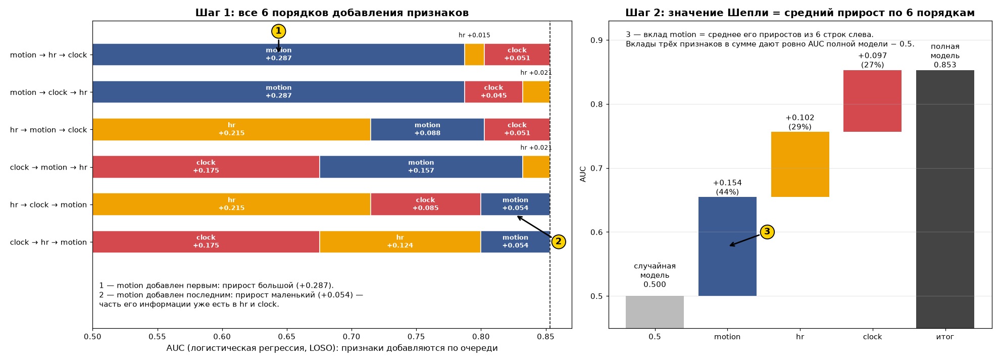
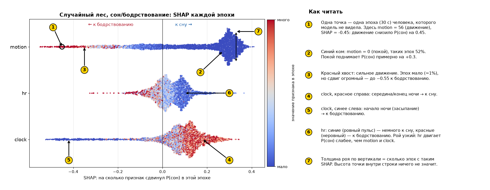
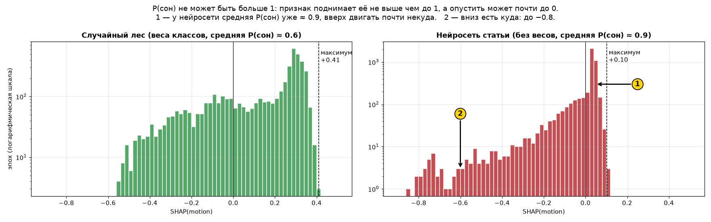
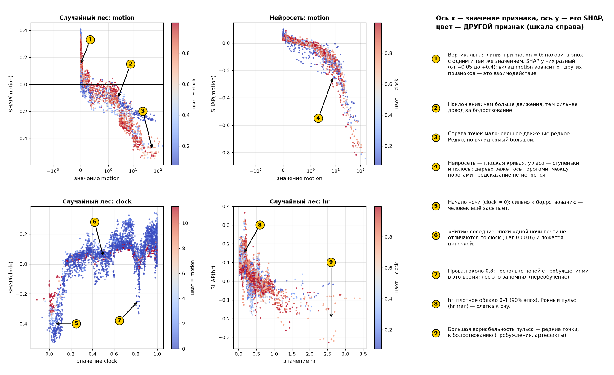
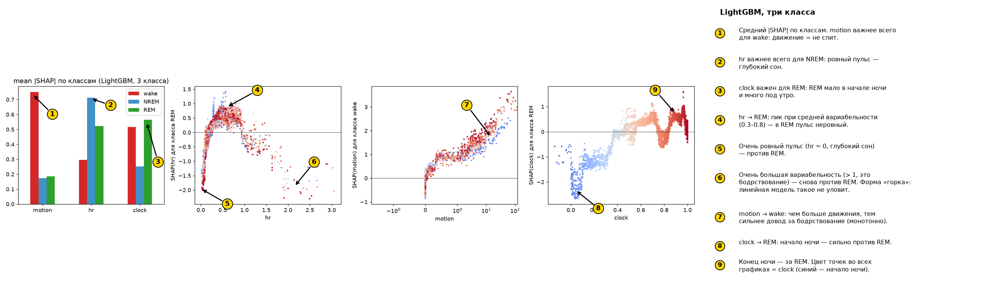
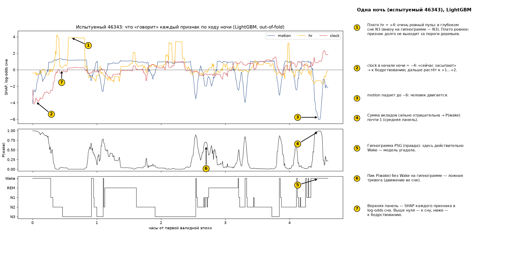
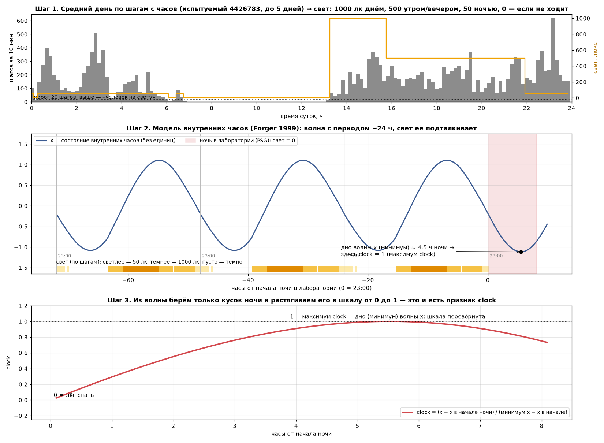

# Как читать графики Шепли и SHAP

Картинки с пронумерованными пояснениями строит `python repro/make_shapley_guide.py` (без обучения). Числа ниже взяты из уже посчитанных результатов `repro/03_feature_importance.py` (31 человек, 25 481 эпоха
по 30 с, 8.4% бодрствования). После `python repro/run_all.py` такие же рисунки появятся для всех пяти моделей
статьи и CatBoost (`outputs/repro/paper_metrics/fig_shapley_*`, `fig_shap_*`).

## 1. Два разных «Шепли»: что именно считается

Значение Шепли пришло из теории игр: несколько игроков вместе получают выигрыш, и его надо честно поделить. Честно —
значит учесть, что вклад игрока зависит от того, кто уже в команде. Поэтому перебираются все порядки, в которых
игроки могут присоединяться, и вклад игрока усредняется по ним. У нас игроки — признаки `motion`, `hr`, `clock`.
Выигрыш можно понимать двумя способами, отсюда два разных вида графиков.

| | Шепли по качеству (`fig_shapley_*`, `A_subsets_shapley`) | SHAP по эпохам (`fig_shap_*`, `D_shap_*`) |
|---|---|---|
| выигрыш | качество модели: AUC, accuracy, κ, F1… | предсказание P(сон) на одной эпохе |
| как считается | модель **переобучается** на каждом из 7 непустых подмножеств признаков | одна обученная модель, признаки «выключаются» подстановкой фоновых значений |
| результат | одно число на признак: сколько качества он приносит | число на **каждую эпоху**: куда и насколько признак сдвинул предсказание |
| отвечает на вопрос | «нужен ли признак модели вообще?» | «как модель использует признак и в какую сторону?» |

### Шепли по качеству

Для трёх признаков есть 7 непустых подмножеств. Для каждого модель обучается заново (LOSO) и меряется качество.
Вклад признака — средний прирост качества, когда его добавляют, по всем 6 порядкам добавления. Например, для
motion у логистической регрессии:

```
порядок            motion добавлен к   прирост AUC
motion, hr, clock  ∅                   AUC(motion) − 0.5
motion, clock, hr  ∅                   AUC(motion) − 0.5
hr, motion, clock  {hr}                AUC(motion+hr) − AUC(hr)
clock, motion, hr  {clock}             AUC(motion+clock) − AUC(clock)
hr, clock, motion  {hr, clock}         AUC(все) − AUC(hr+clock)
clock, hr, motion  {hr, clock}         AUC(все) − AUC(hr+clock)
```

Отсчёт ведётся от **случайной модели**: AUC 0.5; для accuracy, κ и F1 — от модели, которая говорит «сон» в 90% эпох
наугад (тот же порог, что в таблицах: сон найден = 0.9). Главное свойство: **сумма вкладов трёх признаков равна
качеству полной модели минус качество случайной**. Логистическая регрессия: AUC полной модели 0.853, то есть
0.353 над случайной; это 0.155 (motion) + 0.102 (hr) + 0.097 (clock).



_Слева — все 6 порядков добавления признаков (логистическая регрессия): один и тот же motion приносит +0.287, если добавлен первым, и +0.054, если последним. Справа — среднее по порядкам: это и есть значение Шепли._

Рядом с вкладом по Шепли в таблицах ещё два числа:

* **один** — качество признака в одиночку. Motion в одиночку даёт AUC 0.787 (+0.287 над случайной);
* **drop-column** — сколько теряем, если убрать признак из полной модели. Для motion это всего 0.054, для hr у
  нейросети — 0.002.

Эти три числа различаются, потому что признаки **частично дублируют друг друга**. При движении растёт и пульс,
поэтому motion и hr несут часть общей информации. Вместе с motion признак hr почти ничего не добавляет
(drop-column ≈ 0), хотя в одиночку он неплох (AUC 0.70–0.71). Шепли — среднее между этими крайностями: он делит
общую информацию поровну. Поэтому для решения «какой признак убрать» смотрите drop-column, а для «кто сколько
приносит» — Шепли.

### SHAP по эпохам

Берётся модель, обученная **без** этого человека (out-of-fold), и 150 случайных эпох его ночи. Для каждой эпохи
предсказание раскладывается:

```
P(сон | эпоха) = средняя P(сон) по фону + SHAP(motion) + SHAP(hr) + SHAP(clock)
```

«Фон» — 50 случайных эпох обучающих людей, то есть «типичная эпоха». SHAP(motion) = +0.3 значит: «из-за своего
motion эта эпоха выглядит на 0.3 более похожей на сон, чем типичная». Знак показывает направление: **> 0 — к сну,
< 0 — к бодрствованию**. В новых рисунках (`fig_shap_*`) SHAP считается точным перебором всех 2³ = 8 сочетаний
признаков, одинаково для всех моделей, в единицах P(сон). В старых рисунках `D_shap_*` из `03_feature_importance.py`
единицы разные: у случайного леса и нейросети — P(сон), у LightGBM — log-odds сна (поэтому там шкала от −6 до +4).

## 2. Бисворм (рой точек): `fig_shap_beeswarm_models`, `D_shap_beeswarm_*`



_Номера на картинке объяснены справа от неё; ниже — подробнее._

* **Одна точка — одна эпоха** одного человека (31 × 150 ≈ 4 600 точек на строку).
* **Ось x — SHAP**: насколько признак сдвинул P(сон) в этой эпохе. Справа от нуля — к сну, слева — к бодрствованию.
* **Строки** — признаки, сверху вниз по убыванию средней важности (средний |SHAP|).
* **Цвет — значение самого признака в этой эпохе**, а не SHAP:
  * **очень синий** — значение признака у нижней границы (не выше 5-го перцентиля): для motion это полный покой
    (motion = 0), для hr — очень ровный пульс, для clock — самое начало ночи;
  * **ярко-красный** — у верхней границы (от 95-го перцентиля): сильное движение (motion ≥ 9), большая
    вариабельность пульса (hr ≥ 0.9), clock ≈ 1;
  * **фиолетовый** — середина.

  Шкала цвета обрезана по 5-му и 95-му перцентилям. Иначе одна эпоха с motion = 158 сделала бы все остальные
  одинаково синими.
* **Толщина роя по вертикали — сколько эпох** имеют примерно такой SHAP. Вертикальная координата внутри строки
  ничего не значит: точки, которые попали бы друг на друга, раздвигаются вверх и вниз. Где рой толстый — там
  много эпох, где тонкая ниточка — эпох мало.

**Как это читать на примере случайного леса (`D_shap_beeswarm_rf.png`):**

* **motion.** Огромный синий «ком» справа около +0.3: у 52% всех эпох motion ровно 0 (у 56% эпох сна и только у 8%
  эпох бодрствования). Покой — сильный довод за сон, и таких эпох большинство, поэтому ком толстый. Длинный
  красно-фиолетовый «хвост» влево до −0.55: движение — сильный довод за бодрствование, но эпох с движением мало
  (motion > 30 лишь у 1% эпох), поэтому хвост тонкий. Цвета идут по порядку: красные левее фиолетовых, фиолетовые
  левее синих. Значит, чем больше движения, тем сильнее довод за бодрствование: связь **монотонная**.
* **clock.** Синий хвост влево: начало ночи (clock около 0), человек ещё засыпает — модель склоняется к
  бодрствованию. Красная масса справа от нуля: середина и конец ночи — к сну. Синие точки встречаются и справа —
  это значит, что вклад clock зависит и от других признаков (взаимодействия).
* **hr.** Синие (ровный пульс) — немного к сну, красные (неровный пульс) — к бодрствованию, посередине цвета
  перемешаны. Рой узкий: hr двигает P(сон) слабее, чем motion и clock.

**Почему рой несимметричен.** P(сон) не может быть больше 1. У случайного леса средняя P(сон) по фону около 0.6:
признак может поднять её максимум на +0.4, а опустить — на −0.6. Поэтому типичные эпохи сна дают много небольших положительных SHAP (ком
справа), а редкие эпохи бодрствования — немного больших отрицательных (хвост слева). У нейросети статьи весов классов
нет, её средняя P(сон) около 0.92. Поэтому у неё положительные SHAP не больше +0.1, а отрицательные доходят до −0.84:
рой сжат справа. Это свойство шкалы, а не «неважность» признака.



## 3. Графики зависимости: `fig_shap_dependence_models`, `D_shap_dependence_*`



* **Ось x — значение признака**, ось y — его SHAP в той же эпохе. Это «форма» того, как модель использует
  признак: монотонно, с порогом, с пиком.
* **Цвет — значение другого признака**, подписан на шкале справа: для motion и hr — clock, для clock — motion.
  Если при одном x точки разного цвета стоят на разной высоте, модель использует **взаимодействие** признаков.
* У motion ось x — symlog: от −1 до 1 линейная, дальше логарифмическая. Иначе 99% точек сжались бы у нуля, а
  ось растянули бы единичные эпохи с motion ≈ 150.

### Откуда на графиках прямые линии

1. **Вертикальная линия у motion = 0.** Это 52% всех эпох с одним и тем же значением признака, они стоят одна над
   другой. SHAP у них разный (у случайного леса от −0.05 до +0.4) из-за взаимодействий: покой в начале ночи (синий
   цвет, clock мал) говорит о сне меньше, чем покой в середине ночи (красный). Если бы взаимодействий не было, вся
   линия сжалась бы в одну точку.
2. **Горизонтальные полосы и «ступеньки»** у случайного леса, LightGBM и CatBoost. Деревья делят ось признака
   порогами: между двумя порогами предсказание не меняется. Поэтому у целого диапазона значений одинаковый SHAP —
   это и есть горизонтальная полоса. В бисворме такие полосы превращаются в толстые комки.
3. **Гладкие кривые и почти прямые у логистической регрессии.** В log-odds вклад признака в логистической регрессии
   строго линеен: SHAP = w · (x − среднее x), то есть ровная прямая без разброса. В единицах P(сон) прямая
   изгибается сигмоидой, и появляется небольшой разброс: один и тот же сдвиг log-odds по-разному меняет вероятность
   в зависимости от остальных признаков.
4. **Нити и змейки у clock.** Clock меняется по ночи очень плавно: от эпохи к эпохе в среднем на 0.0016 при
   диапазоне от −0.17 до 1. Остальные признаки соседних эпох тоже похожи. Поэтому эпохи одного человека ложатся
   цепочкой, и видна непрерывная «нить» — кусок чьей-то ночи. Резкие провалы (например, у случайного леса около
   clock ≈ 0.8) — несколько ночей, в которых на это время ночи пришлись пробуждения. Лес запомнил их как «в это
   время чаще не спят». Скорее всего, это переобучение на время ночи, а не физиология.
5. **Ровные участки на графике по ходу ночи** (`D_shap_over_night_*`). Признаки сглажены по окнам в несколько
   минут и меняются медленно. Пока все три признака остаются между одними и теми же порогами деревьев, эпохи
   попадают в одни и те же листья, и SHAP не меняется — получается горизонтальный отрезок. Пример — плато hr около
   +4 log-odds в глубоком сне N3: пульс там очень ровный.

### Почему где-то точки плотнее

Плотность на этих графиках — это просто **сколько эпох с такими значениями**, она не говорит о важности.

* motion: половина эпох ровно в нуле (вертикальная линия), 70% меньше 0.1. Справа от 10 — разреженные точки
  (только 5% эпох).
* hr: 90% значений между 0.07 и 0.9, там облако плотное. Значения 1–3.5 встречаются редко: это пробуждения и
  артефакты пульса, точки там одиночные.
* clock: медиана 0.78. Большая часть ночи приходится на верхнюю половину шкалы, начало ночи (clock < 0.2) короткое,
  поэтому слева точек мало.
* Каждый человек даёт ровно 150 эпох. Короткие ночи представлены так же, как длинные, поэтому плотность — это
  распределение «типичной ночи», а не всех 25 тысяч эпох.

Разреженные хвосты при этом часто самые информативные: редкие эпохи с сильным движением дают самые большие по модулю
SHAP. Средний |SHAP| складывается из «много маленьких» и «мало больших», поэтому смотрите оба графика.

## 4. Столбики и тепловая карта Шепли

* **`fig_shapley_auc`, `A_subsets_shapley`.** Слева — AUC каждой модели на всех 7 непустых подмножествах признаков. Сразу
  видно, что motion в одиночку почти так же хорош, как motion + hr, а clock добавляет заметно больше. Справа —
  вклад каждого признака по Шепли в (AUC − 0.5). Цвет столбика — модель. Сравнивать признаки удобно внутри одного
  цвета.
* **`fig_shapley_metrics`** — то же для шести метрик: accuracy, AUC, AP wake, κ, F1 wake, macro F1. В подписи —
  качество случайной модели, от которого считается вклад. По accuracy вклады маленькие: случайная модель с 90%
  «сна» уже даёт accuracy около 0.83 (а «всегда сон» — 0.92), и разница между моделями — сотые. По κ и F1 wake те же признаки выглядят гораздо важнее,
  поэтому важность нельзя оценивать по одной accuracy.
* **`fig_shapley_share`** — доля каждого признака в общем приросте, в процентах. Строки — модели, столбцы — пары
  (метрика, признак), по три признака на метрику, они разделены чёрными линиями. В каждой строке внутри метрики
  сумма = 100%. Красный — признак даёт большую долю прироста. **Синий — доля отрицательная**: в среднем добавление
  признака эту метрику **ухудшает**. Такое возможно у метрик с фиксированным порогом (accuracy, κ, F1): признак
  улучшает ранжирование эпох (AUC), но при пороге «90% сна» добавляет ошибок. Белый — около нуля.
* **`fig_shap_mean_abs`** — средний |SHAP| признака: насколько в среднем он двигает P(сон) в одной эпохе (слева) и
  его доля от суммы (справа). Это глобальная важность **внутри одной модели**. Она не обязана совпадать с Шепли по
  качеству: признак может сильно двигать вероятность, но в основном там, где модель и без него права.

## 5. Три класса: `D_shap_three_class`



* **Слева — средний |SHAP| по классам.** Motion важнее всего для **wake** (движение = не спит). Hr — для **NREM** и
  REM: ровный пульс говорит о глубоком сне, неровный — о REM. Clock — для **REM** и wake: REM редок в начале ночи и
  растёт к утру.
* **Hr → REM (второй график)** — перевёрнутая «U». Очень ровный пульс (hr < 0.15, глубокий сон) — против REM,
  умеренная вариабельность (0.3–0.8) — за REM, очень большая (> 1, бодрствование) — снова против. Поэтому линейная
  модель hr для REM использует плохо: ей нужна прямая, а не горка.
* **Motion → wake** — монотонный рост: чем больше движения, тем сильнее довод за бодрствование.
* **Clock → REM** — ступенчатый рост. Отрицательный SHAP в начале ночи, положительный во второй половине — это
  известная архитектура сна: REM-периоды удлиняются к утру.
* **Цвет во всех трёх точечных графиках — clock** (синий — начало ночи, красный — конец). На последнем графике цвет
  повторяет ось x, поэтому градиент идёт слева направо.

## 6. По ходу ночи: `D_shap_over_night_<id>`



Три панели с общей осью времени (часы от первой эпохи):

1. **SHAP каждого признака** (LightGBM, log-odds; модель обучена без этого человека). Синяя линия motion уходит
   глубоко вниз — человек пошевелился, модель склоняется к бодрствованию. Красная линия clock растёт от −4 в начале
   (засыпание) к +1…+2 под утро. Жёлтые плато hr высоко вверху — ровный пульс глубокого сна.
2. **P(wake)** модели: пики там, где сумма SHAP сильно отрицательна.
3. **Гипнограмма PSG**, то есть правда. Совпадение пиков P(wake) со ступеньками Wake — то, что модель угадала.
   Пик без Wake — ложная тревога (часто движение во сне). Wake без пика — пропущенное «тихое» бодрствование: человек
   лежит неподвижно, motion ≈ 0, и модель уверена в сне. Это главная слабость всех моделей на этих признаках.

## 7. Что такое clock и в чём он измеряется



* **Единиц нет.** Clock — доля пути от «лёг спать» (0) до дна суточного ритма (1). Картинку строит
  `python repro/make_clock_explainer.py <id>` без обучения.
* **Шаг 1.** Шаги с часов за до 5 дней до ночи складываются в «средний день». Если за 10 минут больше 20 шагов,
  человек считается «на свету»: 1000 лк днём (10–16 ч), 500 утром и вечером, 50 ночью. Иначе — темно.
* **Шаг 2.** Свет подаётся в модель внутренних часов Forger 1999. Получается волна x с периодом около 24 ч,
  тоже без единиц. Свет её подталкивает, поэтому у нижних точек видны изломы, и волна — не ровный косинус.
* **Шаг 3.** Из волны берётся кусок ночи и растягивается в 0…1:
  clock = (x − x в начале ночи) / (минимум x − x в начале ночи). Знаменатель отрицательный, поэтому шкала
  **перевёрнута**: дно волны x (минимум внутренних часов) — это **максимум clock = 1**.
* **Ночные данные в clock не входят.** В лаборатории свет считается выключенным, движение и пульс за ночь на
  clock не влияют.
* **За ночь** clock быстро растёт первые 1–2 часа (медиана 0.33 через час и 0.6 через два), держится около 1
  примерно с 4 до 6 ч после отбоя и под утро снова уменьшается (0.81 через 7 ч). Одно и то же значение,
  например 0.8, бывает дважды за ночь.
* **Ограничение.** Время суток в открытых данных неизвестно, поэтому у всех принято начало ночи в 23:00. Из-за
  этого clock у разных людей похож и на деле работает почти как изогнутая шкала «сколько прошло от отбоя».

## 8. Частые вопросы

* **Почему у разных моделей разный масштаб SHAP?** Разная средняя P(сон): модели с весами классов (логистическая
  регрессия, лес, CatBoost) в среднем дают около 0.6, нейросеть без весов — около 0.9. Сравнивайте **доли** и
  **порядок** признаков, а не абсолютные значения.
* **Почему Шепли по качеству и SHAP могут ранжировать признаки по-разному?** Первое меряет, сколько признак
  добавляет к качеству на отложенных людях (с переобучением). Второе — как сильно одна конкретная модель на него
  опирается. Модель может сильно опираться на признак, который дублирует другой; без него она переучилась бы и
  потеряла мало.
* **Можно ли доверять отдельной точке?** Точка — это одна эпоха одного человека, который не участвовал в обучении.
  Смотрите на форму облака и на тенденции, а не на единичные выбросы: у 31 человека и деревьев случайные «провалы»
  неизбежны.
