# Результаты проекта: предсказание стадий сна по Apple Watch

> Снимок прогона `python repro/run_all.py` от 11.10.2026 (5 моделей, CatBoost в режиме из `catboost_config.py`). Картинки — скриншоты из отчёта (`screenshots/`); рисунков, которых нет на скриншотах, здесь нет. Пояснения ко всему — `explained.ipynb` в этой папке.


Сгенерировано `repro/08_results_markdown.py` из готовых результатов (ничего не пересчитывается). Подробнее о модели и метриках — `docs/LOGREG_RU.md` и `docs/F1_RU.md`, о графиках Шепли и SHAP — `docs/SHAPLEY_RU.md` (он же — в конце раздела о важности по Шепли).

**Содержание:** 1. Все метрики статьи: четыре модели статьи и CatBoost · 2. Важность признаков по Шепли: все модели · 3. Воспроизведение статьи (оригинальный код) · 4. Данные (31 испытуемый) · 5. Важность признаков (leave-one-subject-out) · 6. Логистическая регрессия: подробный разбор · 7. Улучшение модели (расширенные признаки, LightGBM, HMM) · 8. Качество по времени ночи · 9. F1-мера · 10. Графики

**Метрики, которые встречаются ниже**

| метрика | что значит |
|---|---|
| Accuracy | доля всех эпох, распознанных верно; при 92% сна «всегда сон» уже даёт 0.92 |
| Сон найден (sensitivity) | доля эпох сна, названных сном; в статье порог подбирают так, чтобы она была 0.80–0.95 |
| Wake найден (specificity) | доля эпох бодрствования, названных бодрствованием — главное слабое место моделей |
| κ (каппа Коэна) | согласие с PSG сверх случайного: 0 — как монетка, 1 — полное |
| AUC | площадь под ROC-кривой: качество разделения сна и бодрствования сразу по всем порогам |
| AP | площадь под precision–recall кривой для wake (рис. 3): честнее AUC при редком wake |
| PPV wake / PPV сон | доля верных среди эпох, названных wake / сном (precision); в коде статьи есть, в таблицах нет |
| F1 | гармоническое среднее precision и recall класса; macro F1 — среднее по классам |
| Сдвиг и границы согласия | Bland–Altman: среднее (PSG − модель) и ±1.96 SD этой разности по людям |

## 1. Все метрики статьи: четыре модели статьи и CatBoost

Протокол: **leave-one-subject-out** (31 фолд): каждый человек предсказывается моделью, обученной на остальных 30. Модели и гиперпараметры — из кода статьи, фиксированные значения из её сеток; CatBoost — из `catboost_config.py` (`repro/09_paper_metrics.py`). В статье — Monte Carlo 70/30 (50 и 20 разбиений) с подбором гиперпараметров на каждом, поэтому числа близки, но не обязаны совпадать до третьего знака. **Жирным** — лучшее значение среди наборов признаков. Таблицы 7–9 и рис. 8–9 (MESA) не воспроизводимы: данные MESA выдаются только по заявке NSRR.

> Рисунки 5–6 используют фиксированные пороги статьи θW = 0.3 и θREM = 0.35, подобранные под нейросеть **без весов классов**. Логистическая регрессия, случайный лес и CatBoost обучены с весами классов, их вероятности бодрствования выше — при тех же порогах они чаще говорят «wake», и сдвиги Bland–Altman у них больше. Сравнивать модели честнее по таблицам 2–6 (порог подбирается одинаково для всех).

### Таблица 1. Сон по PSG (31 человек; источник — outputs/features (валидные эпохи))

| показатель | наши: среднее | наши: SD | наши: мин | наши: макс | статья: среднее | статья: SD |
|---|---|---|---|---|---|---|
| TST, мин | 376.27 | 107.53 | 40 | 474 | 427.87 | 38.87 |
| TIB, мин | 410.98 | 110.36 | 59 | 489 | 472.56 | 27.03 |
| SOL, мин | 12.42 | 8.15 | 2 | 40.5 | 14.97 | 10.1 |
| WASO, мин | 22.29 | 15.59 | 1.5 | 48 | 28.73 | 22.8 |
| SE, % | 90.63 | 5.95 | 67.8 | 98.96 | 90.48 | 5.54 |
| REM, мин | 89.35 | 41.38 | 0 | 151 | 107.15 | 31.22 |
| NREM, мин | 286.92 | 81.34 | 40 | 392.5 | 320.77 | 39.11 |

TIB, TST и время в стадиях у нас меньше, а разброс больше: в открытых данных у 5 человек разметка ночи обрезана до 3.5–4.7 ч (у часов села батарея), а статья считала Таблицу 1 по полной PSG. Показатели, не зависящие от длины ночи (SE, SOL, WASO), совпадают. Возраста в открытых данных нет (в статье 29.4 ± 8.5 года, 21 женщина).

### Сводка: наши значения рядом со статьёй (сон найден = 0.90)

| модель | признаки | accuracy | AUC | AUC статья | wake найден | wake статья | κ | κ статья | AP wake | PPV wake | F1 wake | F1 сон | macro F1 |
|---|---|---|---|---|---|---|---|---|---|---|---|---|---|
| Логистическая регрессия | Motion only | 0.87 | 0.788 | 0.819 | 0.545 | 0.549 | 0.346 | 0.343 | 0.428 | 0.335 | 0.415 | 0.927 | 0.671 |
| Логистическая регрессия | HR only | 0.85 | 0.715 | 0.743 | 0.312 | 0.326 | 0.179 | 0.187 | 0.226 | 0.223 | 0.26 | 0.917 | 0.589 |
| Логистическая регрессия | Motion, HR | 0.87 | 0.818 | 0.83 | 0.547 | 0.546 | 0.348 | 0.341 | 0.433 | 0.336 | 0.416 | 0.927 | 0.671 |
| Логистическая регрессия | Motion, HR, Clock | **0.876** | **0.86** | 0.854 | **0.617** | 0.556 | **0.392** | 0.347 | **0.479** | **0.363** | **0.457** | **0.93** | **0.693** |
| k ближайших соседей | Motion only | 0.863 | 0.724 | 0.803 | 0.464 | 0.483 | 0.292 | 0.3 | 0.308 | 0.3 | 0.364 | 0.923 | 0.644 |
| k ближайших соседей | HR only | 0.845 | 0.669 | 0.682 | 0.247 | 0.237 | 0.128 | 0.117 | 0.151 | 0.185 | 0.212 | 0.914 | 0.563 |
| k ближайших соседей | Motion, HR | 0.867 | 0.825 | 0.81 | 0.513 | 0.496 | 0.325 | 0.308 | 0.414 | 0.321 | 0.395 | 0.925 | 0.66 |
| k ближайших соседей | Motion, HR, Clock | **0.88** | **0.867** | 0.868 | **0.668** | 0.627 | **0.424** | 0.391 | **0.502** | **0.381** | **0.486** | **0.932** | **0.709** |
| Случайный лес | Motion only | 0.868 | 0.817 | 0.81 | 0.518 | 0.53 | 0.328 | 0.329 | 0.419 | 0.323 | 0.398 | 0.926 | 0.662 |
| Случайный лес | HR only | 0.847 | 0.694 | 0.708 | 0.277 | 0.282 | 0.152 | 0.152 | 0.184 | 0.203 | 0.235 | 0.915 | 0.575 |
| Случайный лес | Motion, HR | 0.869 | 0.83 | 0.816 | 0.537 | 0.519 | 0.341 | 0.322 | 0.423 | 0.331 | 0.41 | 0.926 | 0.668 |
| Случайный лес | Motion, HR, Clock | **0.88** | **0.869** | 0.871 | **0.66** | 0.653 | **0.418** | 0.405 | **0.562** | **0.378** | **0.481** | **0.932** | **0.707** |
| Нейросеть (MLP) | Motion only | 0.869 | 0.804 | 0.815 | 0.532 | 0.542 | 0.337 | 0.342 | 0.432 | 0.329 | 0.406 | 0.926 | 0.666 |
| Нейросеть (MLP) | HR only | 0.85 | 0.706 | 0.737 | 0.311 | 0.323 | 0.179 | 0.187 | 0.205 | 0.223 | 0.26 | 0.917 | 0.588 |
| Нейросеть (MLP) | Motion, HR | 0.869 | 0.834 | 0.828 | 0.533 | 0.528 | 0.339 | 0.333 | 0.433 | 0.33 | 0.408 | 0.926 | 0.667 |
| Нейросеть (MLP) | Motion, HR, Clock | **0.881** | **0.877** | 0.878 | **0.677** | 0.675 | **0.429** | 0.424 | **0.56** | **0.385** | **0.491** | **0.933** | **0.712** |
| CatBoost | Motion only | 0.869 | 0.823 |  | 0.537 |  | 0.341 |  | 0.428 | 0.331 | 0.41 | 0.926 | 0.668 |
| CatBoost | HR only | 0.849 | 0.706 |  | 0.298 |  | 0.169 |  | 0.201 | 0.216 | 0.251 | 0.916 | 0.583 |
| CatBoost | Motion, HR | 0.87 | 0.842 |  | 0.543 |  | 0.345 |  | 0.438 | 0.334 | 0.413 | 0.927 | 0.67 |
| CatBoost | Motion, HR, Clock | **0.881** | **0.88** |  | **0.68** |  | **0.431** |  | **0.547** | **0.386** | **0.492** | **0.933** | **0.713** |

### Таблицы 2–5. Сон/бодрствование: все пороги и все метрики

**Логистическая регрессия**

| признаки | сон найден | accuracy | wake найден | κ | AUC | AP wake | PPV wake | PPV сон | F1 wake | F1 сон | macro F1 |
|---|---|---|---|---|---|---|---|---|---|---|---|
| Motion only | 0.8 | 0.793 | 0.717 | 0.279 | 0.788 | 0.428 | 0.248 | 0.968 | 0.369 | 0.876 | 0.623 |
|  | 0.9 | 0.87 | 0.545 | 0.346 |  |  | 0.335 | 0.955 | 0.415 | 0.927 | 0.671 |
|  | 0.93 | 0.891 | 0.466 | 0.359 |  |  | 0.38 | 0.95 | 0.419 | 0.94 | 0.679 |
|  | 0.95 | 0.904 | 0.41 | 0.368 |  |  | 0.43 | 0.946 | 0.42 | 0.948 | 0.684 |
| HR only | 0.8 | 0.77 | 0.447 | 0.142 | 0.715 | 0.226 | 0.171 | 0.94 | 0.247 | 0.864 | 0.556 |
|  | 0.9 | 0.85 | 0.312 | 0.179 |  |  | 0.223 | 0.934 | 0.26 | 0.917 | 0.589 |
|  | 0.93 | 0.874 | 0.261 | 0.189 |  |  | 0.256 | 0.932 | 0.259 | 0.931 | 0.595 |
|  | 0.95 | 0.889 | 0.229 | 0.2 |  |  | 0.297 | 0.93 | 0.259 | 0.94 | 0.599 |
| Motion, HR | 0.8 | 0.79 | 0.68 | 0.261 | 0.818 | 0.433 | 0.239 | 0.964 | 0.353 | 0.875 | 0.614 |
|  | 0.9 | 0.87 | 0.547 | 0.348 |  |  | 0.336 | 0.956 | 0.416 | 0.927 | 0.671 |
|  | 0.93 | 0.892 | 0.476 | 0.367 |  |  | 0.386 | 0.951 | 0.426 | 0.94 | 0.683 |
|  | 0.95 | 0.905 | 0.418 | 0.375 |  |  | 0.435 | 0.947 | 0.427 | 0.948 | 0.687 |
| Motion, HR, Clock | 0.8 | **0.801** | **0.812** | **0.322** | **0.86** | **0.479** | **0.272** | 0.979 | **0.408** | 0.88 | **0.644** |
|  | 0.9 | **0.876** | **0.617** | **0.392** |  |  | **0.363** | 0.962 | **0.457** | 0.93 | **0.693** |
|  | 0.93 | **0.895** | **0.512** | **0.394** |  |  | **0.403** | 0.954 | **0.451** | 0.942 | **0.697** |
|  | 0.95 | **0.907** | **0.436** | **0.39** |  |  | **0.446** | 0.948 | **0.441** | 0.949 | **0.695** |

**k ближайших соседей**

| признаки | сон найден | accuracy | wake найден | κ | AUC | AP wake | PPV wake | PPV сон | F1 wake | F1 сон | macro F1 |
|---|---|---|---|---|---|---|---|---|---|---|---|
| Motion only | 0.8 | 0.788 | 0.664 | 0.253 | 0.724 | 0.308 | 0.234 | 0.963 | 0.346 | 0.874 | 0.61 |
|  | 0.9 | 0.863 | 0.464 | 0.292 |  |  | 0.3 | 0.948 | 0.364 | 0.923 | 0.644 |
|  | 0.93 | 0.884 | 0.388 | 0.298 |  |  | 0.338 | 0.943 | 0.361 | 0.936 | 0.649 |
|  | 0.95 | 0.898 | 0.337 | 0.303 |  |  | 0.383 | 0.94 | 0.359 | 0.945 | 0.652 |
| HR only | 0.8 | 0.765 | 0.389 | 0.11 | 0.669 | 0.151 | 0.152 | 0.934 | 0.218 | 0.862 | 0.54 |
|  | 0.9 | 0.845 | 0.247 | 0.128 |  |  | 0.185 | 0.928 | 0.212 | 0.914 | 0.563 |
|  | 0.93 | 0.867 | 0.187 | 0.12 |  |  | 0.198 | 0.925 | 0.193 | 0.928 | 0.56 |
|  | 0.95 | 0.882 | 0.146 | 0.112 |  |  | 0.212 | 0.923 | 0.173 | 0.936 | 0.555 |
| Motion, HR | 0.8 | 0.791 | 0.691 | 0.266 | 0.825 | 0.414 | 0.241 | 0.966 | 0.358 | 0.875 | 0.617 |
|  | 0.9 | 0.867 | 0.513 | 0.325 |  |  | 0.321 | 0.953 | 0.395 | 0.925 | 0.66 |
|  | 0.93 | 0.889 | 0.45 | 0.347 |  |  | 0.372 | 0.948 | 0.407 | 0.939 | 0.673 |
|  | 0.95 | 0.903 | 0.393 | 0.353 |  |  | 0.42 | 0.944 | 0.406 | 0.947 | 0.677 |
| Motion, HR, Clock | 0.8 | **0.8** | **0.802** | **0.318** | **0.867** | **0.502** | **0.27** | 0.978 | **0.404** | 0.88 | **0.642** |
|  | 0.9 | **0.88** | **0.668** | **0.424** |  |  | **0.381** | 0.967 | **0.486** | 0.932 | **0.709** |
|  | 0.93 | **0.902** | **0.604** | **0.458** |  |  | **0.443** | 0.962 | **0.511** | 0.946 | **0.728** |
|  | 0.95 | **0.913** | **0.519** | **0.456** |  |  | **0.489** | 0.955 | **0.503** | 0.953 | **0.728** |

**Случайный лес**

| признаки | сон найден | accuracy | wake найден | κ | AUC | AP wake | PPV wake | PPV сон | F1 wake | F1 сон | macro F1 |
|---|---|---|---|---|---|---|---|---|---|---|---|
| Motion only | 0.8 | 0.792 | 0.711 | 0.276 | 0.817 | 0.419 | 0.247 | 0.968 | 0.367 | 0.876 | 0.621 |
|  | 0.9 | 0.868 | 0.518 | 0.328 |  |  | 0.323 | 0.953 | 0.398 | 0.926 | 0.662 |
|  | 0.93 | 0.889 | 0.447 | 0.344 |  |  | 0.37 | 0.948 | 0.405 | 0.939 | 0.672 |
|  | 0.95 | 0.903 | 0.392 | 0.353 |  |  | 0.42 | 0.944 | 0.406 | 0.947 | 0.676 |
| HR only | 0.8 | 0.768 | 0.415 | 0.125 | 0.694 | 0.184 | 0.161 | 0.937 | 0.232 | 0.863 | 0.547 |
|  | 0.9 | 0.847 | 0.277 | 0.152 |  |  | 0.203 | 0.931 | 0.235 | 0.915 | 0.575 |
|  | 0.93 | 0.871 | 0.227 | 0.158 |  |  | 0.23 | 0.929 | 0.228 | 0.929 | 0.579 |
|  | 0.95 | 0.886 | 0.192 | 0.162 |  |  | 0.262 | 0.927 | 0.222 | 0.939 | 0.58 |
| Motion, HR | 0.8 | 0.791 | 0.691 | 0.267 | 0.83 | 0.423 | 0.242 | 0.966 | 0.358 | 0.875 | 0.617 |
|  | 0.9 | 0.869 | 0.537 | 0.341 |  |  | 0.331 | 0.955 | 0.41 | 0.926 | 0.668 |
|  | 0.93 | 0.891 | 0.465 | 0.359 |  |  | 0.38 | 0.95 | 0.418 | 0.94 | 0.679 |
|  | 0.95 | 0.905 | 0.414 | 0.372 |  |  | 0.433 | 0.946 | 0.424 | 0.948 | 0.686 |
| Motion, HR, Clock | 0.8 | **0.797** | **0.77** | **0.303** | **0.869** | **0.562** | **0.262** | 0.974 | **0.391** | 0.878 | **0.635** |
|  | 0.9 | **0.88** | **0.66** | **0.418** |  |  | **0.378** | 0.966 | **0.481** | 0.932 | **0.707** |
|  | 0.93 | **0.902** | **0.6** | **0.456** |  |  | **0.442** | 0.962 | **0.509** | 0.946 | **0.727** |
|  | 0.95 | **0.916** | **0.548** | **0.479** |  |  | **0.503** | 0.958 | **0.525** | 0.954 | **0.739** |

**Нейросеть (MLP)**

| признаки | сон найден | accuracy | wake найден | κ | AUC | AP wake | PPV wake | PPV сон | F1 wake | F1 сон | macro F1 |
|---|---|---|---|---|---|---|---|---|---|---|---|
| Motion only | 0.8 | 0.792 | 0.708 | 0.274 | 0.804 | 0.432 | 0.246 | 0.967 | 0.365 | 0.876 | 0.621 |
|  | 0.9 | 0.869 | 0.532 | 0.337 |  |  | 0.329 | 0.954 | 0.406 | 0.926 | 0.666 |
|  | 0.93 | 0.89 | 0.455 | 0.351 |  |  | 0.375 | 0.949 | 0.411 | 0.939 | 0.675 |
|  | 0.95 | 0.904 | 0.407 | 0.365 |  |  | 0.429 | 0.946 | 0.418 | 0.948 | 0.683 |
| HR only | 0.8 | 0.77 | 0.445 | 0.141 | 0.706 | 0.205 | 0.17 | 0.94 | 0.246 | 0.864 | 0.555 |
|  | 0.9 | 0.85 | 0.311 | 0.179 |  |  | 0.223 | 0.934 | 0.26 | 0.917 | 0.588 |
|  | 0.93 | 0.873 | 0.257 | 0.185 |  |  | 0.253 | 0.931 | 0.255 | 0.931 | 0.593 |
|  | 0.95 | 0.889 | 0.23 | 0.201 |  |  | 0.298 | 0.93 | 0.26 | 0.94 | 0.6 |
| Motion, HR | 0.8 | 0.793 | 0.719 | 0.28 | 0.834 | 0.433 | 0.249 | 0.969 | 0.37 | 0.876 | 0.623 |
|  | 0.9 | 0.869 | 0.533 | 0.339 |  |  | 0.33 | 0.954 | 0.408 | 0.926 | 0.667 |
|  | 0.93 | 0.892 | 0.475 | 0.366 |  |  | 0.385 | 0.951 | 0.425 | 0.94 | 0.683 |
|  | 0.95 | 0.905 | 0.415 | 0.373 |  |  | 0.434 | 0.946 | 0.424 | 0.948 | 0.686 |
| Motion, HR, Clock | 0.8 | **0.801** | **0.808** | **0.321** | **0.877** | **0.56** | **0.272** | 0.978 | **0.406** | 0.88 | **0.643** |
|  | 0.9 | **0.881** | **0.677** | **0.429** |  |  | **0.385** | 0.968 | **0.491** | 0.933 | **0.712** |
|  | 0.93 | **0.904** | **0.62** | **0.469** |  |  | **0.45** | 0.964 | **0.521** | 0.947 | **0.734** |
|  | 0.95 | **0.917** | **0.559** | **0.486** |  |  | **0.507** | 0.959 | **0.532** | 0.954 | **0.743** |

**CatBoost**

| признаки | сон найден | accuracy | wake найден | κ | AUC | AP wake | PPV wake | PPV сон | F1 wake | F1 сон | macro F1 |
|---|---|---|---|---|---|---|---|---|---|---|---|
| Motion only | 0.8 | 0.793 | 0.715 | 0.278 | 0.823 | 0.428 | 0.248 | 0.968 | 0.368 | 0.876 | 0.622 |
|  | 0.9 | 0.869 | 0.537 | 0.341 |  |  | 0.331 | 0.955 | 0.41 | 0.926 | 0.668 |
|  | 0.93 | 0.89 | 0.454 | 0.35 |  |  | 0.374 | 0.949 | 0.41 | 0.939 | 0.675 |
|  | 0.95 | 0.903 | 0.396 | 0.356 |  |  | 0.422 | 0.945 | 0.409 | 0.947 | 0.678 |
| HR only | 0.8 | 0.77 | 0.442 | 0.14 | 0.706 | 0.201 | 0.17 | 0.94 | 0.245 | 0.865 | 0.555 |
|  | 0.9 | 0.849 | 0.298 | 0.169 |  |  | 0.216 | 0.933 | 0.251 | 0.916 | 0.583 |
|  | 0.93 | 0.872 | 0.245 | 0.175 |  |  | 0.244 | 0.93 | 0.245 | 0.93 | 0.588 |
|  | 0.95 | 0.888 | 0.219 | 0.19 |  |  | 0.288 | 0.929 | 0.249 | 0.94 | 0.594 |
| Motion, HR | 0.8 | 0.792 | 0.711 | 0.276 | 0.842 | 0.438 | 0.247 | 0.968 | 0.367 | 0.876 | 0.621 |
|  | 0.9 | 0.87 | 0.543 | 0.345 |  |  | 0.334 | 0.955 | 0.413 | 0.927 | 0.67 |
|  | 0.93 | 0.891 | 0.473 | 0.365 |  |  | 0.385 | 0.95 | 0.424 | 0.94 | 0.682 |
|  | 0.95 | 0.905 | 0.423 | 0.379 |  |  | 0.438 | 0.947 | 0.43 | 0.949 | 0.689 |
| Motion, HR, Clock | 0.8 | **0.8** | **0.798** | **0.316** | **0.88** | **0.547** | **0.269** | 0.977 | **0.403** | 0.88 | **0.641** |
|  | 0.9 | **0.881** | **0.68** | **0.431** |  |  | **0.386** | 0.968 | **0.492** | 0.933 | **0.713** |
|  | 0.93 | **0.904** | **0.625** | **0.473** |  |  | **0.452** | 0.964 | **0.525** | 0.947 | **0.736** |
|  | 0.95 | **0.918** | **0.568** | **0.493** |  |  | **0.511** | 0.96 | **0.538** | 0.955 | **0.747** |

### Таблица 6. Wake / NREM / REM (wake найден = 0.6)

| модель | признаки | wake найден | NREM найден | NREM статья | REM найден | REM статья | accuracy (NREM=REM) | κ (NREM=REM) | macro F1 (NREM=REM) | F1 REM (NREM=REM) | лучшая accuracy | accuracy статья | κ (лучшая acc.) | κ статья | macro F1 (лучшая acc.) |
|---|---|---|---|---|---|---|---|---|---|---|---|---|---|---|---|
| Логистическая регрессия | Motion only | 0.6 | 0.411 | 0.506 | 0.409 | 0.332 | 0.427 | 0.06 | 0.398 | 0.278 | 0.644 | 0.71 | 0.147 | 0.085 | 0.398 |
| Логистическая регрессия | HR only | 0.6 | 0.387 | 0.452 | 0.388 | 0.453 | 0.405 | 0.134 | 0.357 | 0.293 | 0.568 | 0.698 | 0.161 | 0.033 | 0.334 |
| Логистическая регрессия | Motion, HR | 0.6 | 0.582 | 0.625 | 0.579 | 0.625 | 0.583 | 0.281 | 0.506 | 0.455 | 0.649 | 0.701 | 0.162 | 0.161 | 0.388 |
| Логистическая регрессия | Motion, HR, Clock | 0.6 | **0.645** | 0.623 | **0.642** | 0.623 | **0.64** | **0.337** | **0.572** | **0.498** | **0.688** | 0.699 | **0.175** | 0.13 | **0.432** |
| k ближайших соседей | Motion only | 0.6 | 0.377 | 0.294 | 0.479 | 0.532 | 0.418 | 0.095 | 0.391 | 0.31 | 0.637 | 0.698 | 0.149 | 0.072 | 0.383 |
| k ближайших соседей | HR only | 0.6 | 0.369 | 0.402 | 0.368 | 0.402 | 0.388 | 0.121 | 0.344 | 0.298 | 0.519 | 0.671 | 0.118 | 0.108 | 0.316 |
| k ближайших соседей | Motion, HR | 0.6 | 0.56 | 0.607 | 0.56 | 0.605 | 0.564 | 0.252 | 0.492 | 0.431 | 0.647 | 0.711 | 0.156 | 0.227 | 0.39 |
| k ближайших соседей | Motion, HR, Clock | 0.6 | **0.634** | 0.648 | **0.637** | 0.647 | **0.631** | **0.323** | **0.571** | **0.481** | **0.697** | 0.721 | **0.184** | 0.243 | **0.442** |
| Случайный лес | Motion only | 0.6 | 0.435 | 0.397 | 0.432 | 0.441 | 0.448 | 0.102 | 0.41 | 0.293 | 0.654 | 0.702 | 0.161 | 0.075 | 0.393 |
| Случайный лес | HR only | 0.6 | 0.392 | 0.434 | 0.393 | 0.434 | 0.409 | 0.143 | 0.361 | 0.319 | 0.531 | 0.676 | 0.131 | 0.165 | 0.326 |
| Случайный лес | Motion, HR | 0.6 | 0.585 | 0.615 | 0.587 | 0.615 | 0.586 | 0.281 | 0.512 | 0.455 | 0.659 | 0.695 | 0.201 | 0.293 | 0.444 |
| Случайный лес | Motion, HR, Clock | 0.6 | **0.633** | 0.638 | **0.631** | 0.638 | **0.63** | **0.319** | **0.566** | **0.482** | **0.695** | 0.686 | **0.249** | 0.302 | **0.514** |
| Нейросеть (MLP) | Motion only | 0.6 | 0.437 | 0.394 | 0.427 | 0.498 | 0.448 | 0.1 | 0.409 | 0.293 | 0.653 | 0.713 | 0.16 | 0.084 | 0.392 |
| Нейросеть (MLP) | HR only | 0.6 | 0.375 | 0.454 | 0.377 | 0.454 | 0.394 | 0.128 | 0.349 | 0.289 | 0.553 | 0.698 | 0.155 | 0.04 | 0.334 |
| Нейросеть (MLP) | Motion, HR | 0.6 | 0.594 | 0.622 | 0.596 | 0.622 | 0.595 | 0.29 | 0.52 | 0.465 | 0.656 | 0.723 | 0.156 | 0.256 | 0.397 |
| Нейросеть (MLP) | Motion, HR, Clock | 0.6 | **0.643** | 0.651 | **0.641** | 0.65 | **0.639** | **0.33** | **0.583** | **0.482** | **0.707** | 0.723 | **0.228** | 0.277 | **0.495** |
| CatBoost | Motion only | 0.6 | 0.428 |  | 0.44 |  | 0.445 | 0.103 | 0.41 | 0.296 | 0.655 |  | 0.162 |  | 0.394 |
| CatBoost | HR only | 0.6 | 0.381 |  | 0.378 |  | 0.399 | 0.131 | 0.352 | 0.291 | 0.554 |  | 0.151 |  | 0.327 |
| CatBoost | Motion, HR | 0.6 | 0.601 |  | 0.598 |  | 0.6 | 0.297 | 0.523 | 0.47 | 0.661 |  | 0.243 |  | 0.49 |
| CatBoost | Motion, HR, Clock | 0.6 | **0.649** |  | **0.654** |  | **0.646** | **0.342** | **0.586** | **0.497** | **0.704** |  | **0.244** |  | **0.512** |

Две рабочие точки на одной и той же модели. «NREM=REM» — порог, при котором доли найденных NREM и REM уравнены (как сплошные линии на рис. 4). «Лучшая accuracy» — точка, где статья берёт accuracy и κ; именно там видно, как accuracy ≈ 0.70 достигается почти без REM.

**Классификация при фиксированных порогах статьи** (θW = 0.3, θREM = 0.35, как для рис. 5)

| модель | признаки | accuracy | κ | wake найден | NREM найден | REM найден | F1 wake | F1 NREM | F1 REM | macro F1 |
|---|---|---|---|---|---|---|---|---|---|---|
| Логистическая регрессия | Motion only | 0.239 | 0.05 | 0.565 | 0.002 | **0.873** | **0.404** | 0.003 | 0.357 | 0.255 |
| Логистическая регрессия | HR only | **0.563** | 0.164 | 0.619 | **0.732** | 0 | 0.236 | **0.763** | 0 | 0.333 |
| Логистическая регрессия | Motion, HR | 0.418 | **0.17** | 0.612 | 0.296 | 0.734 | 0.359 | 0.448 | 0.405 | **0.404** |
| Логистическая регрессия | Motion, HR, Clock | 0.334 | 0.13 | **0.801** | 0.15 | 0.744 | 0.342 | 0.256 | **0.412** | 0.337 |
| k ближайших соседей | Motion only | 0.662 | 0.116 | 0.332 | **0.883** | 0.081 | 0.357 | **0.795** | 0.121 | 0.424 |
| k ближайших соседей | HR only | 0.626 | 0.143 | 0.132 | 0.785 | 0.31 | 0.162 | 0.764 | 0.314 | 0.413 |
| k ближайших соседей | Motion, HR | 0.658 | 0.22 | 0.316 | 0.787 | 0.374 | 0.39 | 0.77 | 0.374 | 0.511 |
| k ближайших соседей | Motion, HR, Clock | **0.68** | **0.305** | **0.414** | 0.773 | **0.486** | **0.465** | 0.778 | **0.456** | **0.567** |
| Случайный лес | Motion only | 0.218 | 0.047 | **0.78** | 0.007 | 0.677 | 0.331 | 0.014 | 0.328 | 0.225 |
| Случайный лес | HR only | 0.437 | 0.157 | 0.626 | 0.451 | 0.317 | 0.213 | **0.599** | 0.304 | 0.372 |
| Случайный лес | Motion, HR | 0.502 | 0.248 | 0.748 | 0.435 | 0.622 | 0.34 | 0.591 | 0.45 | 0.46 |
| Случайный лес | Motion, HR, Clock | **0.527** | **0.261** | 0.743 | **0.452** | **0.684** | **0.418** | 0.598 | **0.462** | **0.492** |
| Нейросеть (MLP) | Motion only | **0.704** | 0.118 | 0.328 | **0.969** | 0 | 0.4 | **0.823** | 0 | 0.408 |
| Нейросеть (MLP) | HR only | 0.654 | 0.172 | 0.097 | 0.819 | 0.34 | 0.157 | 0.782 | 0.341 | 0.427 |
| Нейросеть (MLP) | Motion, HR | 0.666 | 0.261 | 0.345 | 0.777 | 0.435 | 0.416 | 0.774 | 0.413 | 0.534 |
| Нейросеть (MLP) | Motion, HR, Clock | 0.674 | **0.319** | **0.528** | 0.744 | **0.504** | **0.541** | 0.769 | **0.453** | **0.588** |
| CatBoost | Motion only | 0.211 | 0.046 | 0.804 | 0 | 0.66 | 0.329 | 0 | 0.323 | 0.217 |
| CatBoost | HR only | 0.443 | 0.152 | 0.744 | **0.505** | 0.129 | 0.22 | **0.644** | 0.169 | 0.344 |
| CatBoost | Motion, HR | 0.499 | 0.252 | **0.811** | 0.431 | 0.596 | 0.336 | 0.589 | 0.454 | 0.46 |
| CatBoost | Motion, HR, Clock | **0.535** | **0.282** | 0.786 | 0.45 | **0.71** | **0.425** | 0.603 | **0.478** | **0.502** |

### Рисунок 5. Bland–Altman: показатели сна (θW = 0.3, θREM = 0.35, Motion, HR, Clock)

Сдвиг = среднее (PSG − модель) по людям: положительный — модель **недооценивает** показатель. Границы согласия = сдвиг ± 1.96 SD: чем уже, тем надёжнее оценка для отдельного человека.

| показатель | Логистическая регрессия: сдвиг | границы | k ближайших соседей: сдвиг | границы | Случайный лес: сдвиг | границы | Нейросеть (MLP): сдвиг | границы | CatBoost: сдвиг | границы |
|---|---|---|---|---|---|---|---|---|---|---|
| TST, мин | 93.419 | [23.22; 163.62] | -7.71 | [-49.07; 33.65] | 53.984 | [-17.04; 125.01] | -1.629 | [-43.45; 40.19] | 59 | [-17.08; 135.08] |
| SOL, мин | -54.5 | [-96.71; -12.29] | 9.516 | [-8.23; 27.26] | -8.887 | [-31.94; 14.16] | -2.339 | [-18.60; 13.93] | -9.016 | [-29.29; 11.26] |
| WASO, мин | -38.919 | [-107.18; 29.34] | -1.806 | [-39.32; 35.70] | -45.097 | [-113.22; 23.03] | 3.968 | [-36.57; 44.51] | -49.984 | [-123.91; 23.95] |
| SE (доля) | 0.248 | [0.02; 0.47] | -0.023 | [-0.13; 0.09] | 0.138 | [-0.03; 0.31] | -0.005 | [-0.11; 0.10] | 0.151 | [-0.04; 0.34] |
| REM, мин | -143.387 | [-273.09; -13.68] | -11.839 | [-89.43; 65.75] | -86.226 | [-189.67; 17.21] | -20.016 | [-104.54; 64.50] | -86.806 | [-191.51; 17.89] |
| NREM, мин | 236.806 | [90.69; 382.92] | 4.129 | [-75.63; 83.89] | 140.21 | [14.84; 265.58] | 18.387 | [-70.65; 107.42] | 145.806 | [18.43; 273.19] |

**Классификация эпох при тех же порогах** (Motion, HR, Clock; из этих предсказаний и считаются показатели сна выше)

| модель | accuracy | κ | wake найден | NREM найден | REM найден | F1 wake | F1 REM | macro F1 |
|---|---|---|---|---|---|---|---|---|
| Логистическая регрессия | 0.334 | 0.13 | **0.801** | 0.15 | **0.744** | 0.342 | 0.412 | 0.337 |
| k ближайших соседей | **0.68** | 0.305 | 0.414 | **0.773** | 0.486 | 0.465 | 0.456 | 0.567 |
| Случайный лес | 0.527 | 0.261 | 0.743 | 0.452 | 0.684 | 0.418 | 0.462 | 0.492 |
| Нейросеть (MLP) | 0.674 | **0.319** | 0.528 | 0.744 | 0.504 | **0.541** | 0.453 | **0.588** |
| CatBoost | 0.535 | 0.282 | 0.786 | 0.45 | 0.71 | 0.425 | **0.478** | 0.502 |

**Нейросеть (MLP): все наборы признаков**

| показатель | признаки | сдвиг | SD | границы |
|---|---|---|---|---|
| TST, мин | Motion only | -12.419 | 19.973 | [-51.57; 26.73] |
| SOL, мин | Motion only | 10.032 | 8.553 | [-6.73; 26.80] |
| WASO, мин | Motion only | 2.387 | 18.27 | [-33.42; 38.20] |
| SE (доля) | Motion only | -0.038 | 0.069 | [-0.17; 0.10] |
| REM, мин | Motion only | 89.355 | 41.375 | [8.26; 170.45] |
| NREM, мин | Motion only | -101.774 | 46.048 | [-192.03; -11.52] |
|  | HR only | -26.484 | 17.783 | [-61.34; 8.37] |
|  | HR only | 12.194 | 8.314 | [-4.10; 28.49] |
|  | HR only | 14.29 | 16.619 | [-18.28; 46.86] |
|  | HR only | -0.074 | 0.062 | [-0.20; 0.05] |
|  | HR only | 0.323 | 54.935 | [-107.35; 107.99] |
|  | HR only | -26.806 | 53.523 | [-131.71; 78.10] |
|  | Motion, HR | -11.823 | 20.486 | [-51.98; 28.33] |
|  | Motion, HR | 9.968 | 8.605 | [-6.90; 26.83] |
|  | Motion, HR | 1.855 | 18.101 | [-33.62; 37.33] |
|  | Motion, HR | -0.037 | 0.068 | [-0.17; 0.10] |
|  | Motion, HR | -9.484 | 40.749 | [-89.35; 70.39] |
|  | Motion, HR | -2.339 | 38.841 | [-78.47; 73.79] |
|  | Motion, HR, Clock | -1.629 | 21.336 | [-43.45; 40.19] |
|  | Motion, HR, Clock | -2.339 | 8.298 | [-18.60; 13.93] |
|  | Motion, HR, Clock | 3.968 | 20.685 | [-36.57; 44.51] |
|  | Motion, HR, Clock | -0.005 | 0.051 | [-0.11; 0.10] |
|  | Motion, HR, Clock | -20.016 | 43.122 | [-104.54; 64.50] |
|  | Motion, HR, Clock | 18.387 | 45.425 | [-70.65; 107.42] |

### Рисунок 6. Качество по людям (Motion, HR, Clock, P(wake) ≥ 0.3 → wake)

| модель | метрика | мин | 25% | медиана | 75% | макс |
|---|---|---|---|---|---|---|
| Логистическая регрессия | accuracy | 0.038 | 0.299 | 0.366 | 0.421 | 0.543 |
|  | wake найден | 0.709 | 0.976 | 1 | 1 | 1 |
|  | сон найден | 0 | 0.237 | 0.311 | 0.367 | 0.476 |
|  | κ | -0.024 | 0.018 | 0.05 | 0.087 | 0.188 |
|  | AUC | 0.688 | 0.849 | 0.9 | 0.936 | 0.996 |
|  | F1 wake | 0.026 | 0.14 | 0.215 | 0.25 | 0.487 |
|  | F1 сон | 0 | 0.383 | 0.47 | 0.536 | 0.645 |
|  | macro F1 | 0.036 | 0.258 | 0.335 | 0.391 | 0.503 |
| k ближайших соседей | accuracy | 0.822 | 0.899 | 0.917 | 0.928 | 0.986 |
|  | wake найден | 0.114 | 0.342 | 0.439 | 0.526 | 1 |
|  | сон найден | 0.892 | 0.96 | 0.973 | 0.985 | 0.999 |
|  | κ | 0.159 | 0.326 | 0.434 | 0.501 | 0.787 |
|  | AUC | 0.693 | 0.86 | 0.908 | 0.945 | 0.995 |
|  | F1 wake | 0.175 | 0.362 | 0.491 | 0.545 | 0.794 |
|  | F1 сон | 0.883 | 0.945 | 0.954 | 0.962 | 0.993 |
|  | macro F1 | 0.562 | 0.658 | 0.714 | 0.75 | 0.893 |
| Случайный лес | accuracy | 0.54 | 0.679 | 0.768 | 0.803 | 0.872 |
|  | wake найден | 0.598 | 0.767 | 0.89 | 0.972 | 1 |
|  | сон найден | 0.524 | 0.62 | 0.767 | 0.809 | 0.881 |
|  | κ | 0.028 | 0.17 | 0.276 | 0.368 | 0.542 |
|  | AUC | 0.734 | 0.863 | 0.909 | 0.953 | 0.996 |
|  | F1 wake | 0.048 | 0.259 | 0.372 | 0.457 | 0.685 |
|  | F1 сон | 0.687 | 0.764 | 0.858 | 0.879 | 0.927 |
|  | macro F1 | 0.391 | 0.519 | 0.622 | 0.677 | 0.768 |
| Нейросеть (MLP) | accuracy | 0.839 | 0.899 | 0.922 | 0.942 | 0.992 |
|  | wake найден | 0.161 | 0.392 | 0.553 | 0.704 | 1 |
|  | сон найден | 0.89 | 0.952 | 0.965 | 0.982 | 1 |
|  | κ | 0.145 | 0.388 | 0.483 | 0.616 | 0.89 |
|  | AUC | 0.719 | 0.882 | 0.923 | 0.958 | 0.997 |
|  | F1 wake | 0.161 | 0.439 | 0.542 | 0.661 | 0.895 |
|  | F1 сон | 0.891 | 0.944 | 0.957 | 0.969 | 0.996 |
|  | macro F1 | 0.552 | 0.689 | 0.739 | 0.807 | 0.945 |
| CatBoost | accuracy | 0.493 | 0.647 | 0.744 | 0.789 | 0.849 |
|  | wake найден | 0.634 | 0.827 | 0.941 | 0.979 | 1 |
|  | сон найден | 0.476 | 0.58 | 0.727 | 0.777 | 0.846 |
|  | κ | 0.023 | 0.146 | 0.27 | 0.347 | 0.507 |
|  | AUC | 0.751 | 0.885 | 0.922 | 0.956 | 0.997 |
|  | F1 wake | 0.043 | 0.247 | 0.364 | 0.445 | 0.667 |
|  | F1 сон | 0.644 | 0.733 | 0.837 | 0.867 | 0.915 |
|  | macro F1 | 0.369 | 0.498 | 0.608 | 0.656 | 0.748 |

### Рисунок 7. Порог под каждого человека

| модель | сон найден (порог под человека) | accuracy, медиана | wake найден, медиана | κ, медиана | F1 wake, медиана | macro F1, медиана |
|---|---|---|---|---|---|---|
| Логистическая регрессия | 0.8 | 0.803 | 0.882 | 0.285 | 0.378 | 0.62 |
|  | 0.9 | 0.879 | 0.723 | 0.409 | 0.473 | 0.702 |
|  | 0.93 | 0.898 | 0.573 | 0.433 | 0.5 | 0.717 |
|  | 0.95 | 0.911 | 0.5 | 0.427 | 0.5 | 0.713 |
| k ближайших соседей | 0.8 | 0.805 | 0.882 | 0.307 | 0.405 | 0.641 |
|  | 0.9 | 0.885 | 0.739 | 0.433 | 0.495 | 0.714 |
|  | 0.93 | 0.905 | 0.681 | 0.459 | 0.528 | 0.73 |
|  | 0.95 | 0.918 | 0.62 | 0.488 | 0.534 | 0.744 |
| Случайный лес | 0.8 | 0.802 | 0.824 | 0.292 | 0.395 | 0.636 |
|  | 0.9 | 0.884 | 0.711 | 0.433 | 0.495 | 0.714 |
|  | 0.93 | 0.905 | 0.649 | 0.475 | 0.521 | 0.737 |
|  | 0.95 | 0.918 | 0.617 | 0.496 | 0.545 | 0.746 |
| Нейросеть (MLP) | 0.8 | 0.804 | 0.882 | 0.313 | 0.415 | 0.641 |
|  | 0.9 | 0.892 | 0.788 | 0.446 | 0.512 | 0.722 |
|  | 0.93 | 0.908 | 0.706 | 0.495 | 0.534 | 0.747 |
|  | 0.95 | 0.922 | 0.67 | 0.501 | 0.561 | 0.75 |
| CatBoost | 0.8 | 0.804 | 0.878 | 0.313 | 0.416 | 0.646 |
|  | 0.9 | 0.885 | 0.734 | 0.42 | 0.498 | 0.709 |
|  | 0.93 | 0.907 | 0.681 | 0.466 | 0.521 | 0.732 |
|  | 0.95 | 0.921 | 0.585 | 0.504 | 0.552 | 0.752 |

## 2. Важность признаков по Шепли: все модели

Два независимых взгляда, оба — leave-one-subject-out, для тех же моделей, что и в метриках статьи (`repro/09_paper_metrics.py`):

* **Значения Шепли по качеству.** Каждая модель переобучена на всех 7 подмножествах признаков {motion, hr, clock}. «Игра» v(S) = метрика модели на признаках S − метрика случайной модели, которая говорит «сон» в 90% эпох наугад (accuracy, AUC 0.5, AP = доля wake, κ 0, F1 wake, macro F1). Значение Шепли — средний прирост метрики от признака по всем порядкам добавления; сумма по признакам = прирост полной модели. Рядом: **drop-column** — сколько теряем, убрав признак из полной модели, и **один** — качество признака в одиночку (тоже над случайной моделью).

* **SHAP по эпохам.** Модель на Motion, HR, Clock, обученная без человека, объясняет 150 его случайных эпох: на сколько каждый признак сдвигает P(сон) относительно средней по фону (50 обучающих эпох). Точный перебор 2³ коалиций — одинаковый для всех моделей, поэтому значения сравнимы между моделями.

### Качество на всех подмножествах признаков (сон/бодрствование, сон найден = 0.90)

Из этих чисел и складываются значения Шепли ниже. **Жирным** — лучшее подмножество у модели.

| модель | признаки | accuracy | сон найден | wake найден | κ | AUC | AP wake | PPV wake | F1 wake | F1 сон | macro F1 |
|---|---|---|---|---|---|---|---|---|---|---|---|
| Логистическая регрессия | Motion only | 0.87 | 0.9 | 0.545 | 0.346 | 0.788 | 0.428 | 0.335 | 0.415 | 0.927 | 0.671 |
|  | HR only | 0.85 | 0.9 | 0.312 | 0.179 | 0.715 | 0.226 | 0.223 | 0.26 | 0.917 | 0.589 |
|  | Clock only | 0.859 | 0.9 | 0.409 | 0.252 | 0.674 | 0.314 | 0.274 | 0.328 | 0.921 | 0.625 |
|  | Motion, HR | 0.87 | 0.9 | 0.547 | 0.348 | 0.818 | 0.433 | 0.336 | 0.416 | 0.927 | 0.671 |
|  | Motion, Clock | **0.877** | 0.9 | **0.624** | **0.397** | 0.847 | 0.468 | **0.365** | **0.461** | **0.93** | **0.696** |
|  | HR, Clock | 0.869 | 0.9 | 0.536 | 0.34 | 0.8 | 0.329 | 0.331 | 0.409 | 0.926 | 0.668 |
|  | Motion, HR, Clock | 0.876 | 0.9 | 0.617 | 0.392 | **0.86** | **0.479** | 0.363 | 0.457 | 0.93 | 0.693 |
| k ближайших соседей | Motion only | 0.863 | 0.9 | 0.464 | 0.292 | 0.724 | 0.308 | 0.3 | 0.364 | 0.923 | 0.644 |
|  | HR only | 0.845 | 0.9 | 0.247 | 0.128 | 0.669 | 0.151 | 0.185 | 0.212 | 0.914 | 0.563 |
|  | Clock only | 0.858 | 0.9 | 0.401 | 0.247 | 0.661 | 0.291 | 0.27 | 0.323 | 0.921 | 0.622 |
|  | Motion, HR | 0.867 | 0.9 | 0.513 | 0.325 | 0.825 | 0.414 | 0.321 | 0.395 | 0.925 | 0.66 |
|  | Motion, Clock | 0.88 | 0.9 | 0.66 | 0.418 | 0.866 | 0.493 | 0.378 | 0.481 | 0.932 | 0.707 |
|  | HR, Clock | 0.871 | 0.9 | 0.554 | 0.352 | 0.808 | 0.398 | 0.338 | 0.42 | 0.927 | 0.674 |
|  | Motion, HR, Clock | **0.88** | 0.9 | **0.668** | **0.424** | **0.867** | **0.502** | **0.381** | **0.486** | **0.932** | **0.709** |
| Случайный лес | Motion only | 0.868 | 0.9 | 0.518 | 0.328 | 0.817 | 0.419 | 0.323 | 0.398 | 0.926 | 0.662 |
|  | HR only | 0.847 | 0.9 | 0.277 | 0.152 | 0.694 | 0.184 | 0.203 | 0.235 | 0.915 | 0.575 |
|  | Clock only | 0.86 | 0.9 | 0.427 | 0.266 | 0.666 | 0.377 | 0.283 | 0.34 | 0.922 | 0.631 |
|  | Motion, HR | 0.869 | 0.9 | 0.537 | 0.341 | 0.83 | 0.423 | 0.331 | 0.41 | 0.926 | 0.668 |
|  | Motion, Clock | 0.878 | 0.9 | 0.636 | 0.404 | 0.86 | 0.558 | 0.37 | 0.468 | 0.931 | 0.699 |
|  | HR, Clock | 0.87 | 0.9 | 0.545 | 0.346 | 0.799 | 0.415 | 0.335 | 0.414 | 0.927 | 0.671 |
|  | Motion, HR, Clock | **0.88** | 0.9 | **0.66** | **0.418** | **0.869** | **0.562** | **0.378** | **0.481** | **0.932** | **0.707** |
| Нейросеть (MLP) | Motion only | 0.869 | 0.9 | 0.532 | 0.337 | 0.804 | 0.432 | 0.329 | 0.406 | 0.926 | 0.666 |
|  | HR only | 0.85 | 0.9 | 0.311 | 0.179 | 0.706 | 0.205 | 0.223 | 0.26 | 0.917 | 0.588 |
|  | Clock only | 0.858 | 0.9 | 0.407 | 0.251 | 0.608 | 0.309 | 0.273 | 0.327 | 0.921 | 0.624 |
|  | Motion, HR | 0.869 | 0.9 | 0.533 | 0.339 | 0.834 | 0.433 | 0.33 | 0.408 | 0.926 | 0.667 |
|  | Motion, Clock | 0.88 | 0.9 | 0.667 | 0.423 | 0.87 | **0.577** | 0.381 | 0.485 | 0.932 | 0.709 |
|  | HR, Clock | 0.873 | 0.9 | 0.579 | 0.368 | 0.826 | 0.462 | 0.348 | 0.435 | 0.928 | 0.682 |
|  | Motion, HR, Clock | **0.881** | 0.9 | **0.677** | **0.429** | **0.877** | 0.56 | **0.385** | **0.491** | **0.933** | **0.712** |
| CatBoost | Motion only | 0.869 | 0.9 | 0.537 | 0.341 | 0.823 | 0.428 | 0.331 | 0.41 | 0.926 | 0.668 |
|  | HR only | 0.849 | 0.9 | 0.298 | 0.169 | 0.706 | 0.201 | 0.216 | 0.251 | 0.916 | 0.583 |
|  | Clock only | 0.86 | 0.9 | 0.426 | 0.265 | 0.669 | 0.318 | 0.282 | 0.339 | 0.922 | 0.63 |
|  | Motion, HR | 0.87 | 0.9 | 0.543 | 0.345 | 0.842 | 0.438 | 0.334 | 0.413 | 0.927 | 0.67 |
|  | Motion, Clock | 0.88 | 0.9 | 0.664 | 0.421 | 0.873 | 0.543 | 0.38 | 0.483 | 0.932 | 0.708 |
|  | HR, Clock | 0.872 | 0.9 | 0.57 | 0.362 | 0.819 | 0.421 | 0.345 | 0.43 | 0.928 | 0.679 |
|  | Motion, HR, Clock | **0.881** | 0.9 | **0.68** | **0.431** | **0.88** | **0.547** | **0.386** | **0.492** | **0.933** | **0.713** |

### Значения Шепли по метрикам

Все числа — прирост над случайной моделью, которая говорит «сон» в 90% эпох наугад (её качество: accuracy 0.832, AUC 0.500, AP wake 0.085, κ 0.000, F1 wake 0.092, macro F1 0.500). Сумма значений Шепли трёх признаков = качество полной модели − качество случайной. **Жирным** — самый важный признак у модели.

| модель | признак | Шепли AUC | доля AUC | drop-column AUC | один AUC | Шепли accuracy | Шепли AP wake | Шепли κ | Шепли F1 wake | Шепли macro F1 |
|---|---|---|---|---|---|---|---|---|---|---|
| Логистическая регрессия | motion | **0.162** | 45% | **0.059** | **0.288** | **0.021** | **0.225** | **0.185** | **0.172** | **0.091** |
|  | hr | 0.102 | 28% | 0.013 | 0.215 | 0.008 | 0.054 | 0.073 | 0.069 | 0.036 |
|  | clock | 0.096 | 27% | 0.042 | 0.174 | 0.015 | 0.116 | 0.134 | 0.125 | 0.066 |
| k ближайших соседей | motion | **0.154** | 42% | **0.059** | **0.224** | **0.021** | **0.187** | **0.182** | **0.17** | **0.09** |
|  | hr | 0.098 | 27% | 0.001 | 0.169 | 0.007 | 0.061 | 0.067 | 0.063 | 0.033 |
|  | clock | 0.115 | 31% | 0.042 | 0.161 | 0.02 | 0.17 | 0.174 | 0.161 | 0.086 |
| Случайный лес | motion | **0.184** | 50% | **0.07** | **0.317** | **0.022** | **0.231** | **0.188** | **0.175** | **0.093** |
|  | hr | 0.092 | 25% | 0.009 | 0.194 | 0.008 | 0.042 | 0.071 | 0.067 | 0.035 |
|  | clock | 0.093 | 25% | 0.039 | 0.166 | 0.018 | 0.206 | 0.159 | 0.148 | 0.079 |
| Нейросеть (MLP) | motion | **0.184** | 49% | **0.052** | **0.304** | **0.022** | **0.231** | **0.188** | **0.175** | **0.093** |
|  | hr | 0.112 | 30% | 0.007 | 0.206 | 0.009 | 0.06 | 0.082 | 0.076 | 0.04 |
|  | clock | 0.082 | 22% | 0.044 | 0.108 | 0.018 | 0.184 | 0.16 | 0.148 | 0.079 |
| CatBoost | motion | **0.185** | 49% | **0.061** | **0.323** | **0.022** | **0.234** | **0.192** | **0.178** | **0.095** |
|  | hr | 0.099 | 26% | 0.007 | 0.206 | 0.008 | 0.059 | 0.077 | 0.072 | 0.038 |
|  | clock | 0.096 | 25% | 0.038 | 0.169 | 0.019 | 0.17 | 0.163 | 0.151 | 0.08 |

### SHAP: средний сдвиг P(сон) от признака (Motion, HR, Clock)

«Направление» — знак связи между значением признака и его SHAP: «больше → сон» значит, что чем больше признак, тем выше P(сон). Справа — качество объясняемой модели (сон найден = 0.90), чтобы было видно, насколько ей стоит доверять.

| модель | признак | mean \|SHAP\| | доля | средний SHAP | Спирмен (значение, SHAP) | направление | accuracy модели | κ модели | AUC модели | F1 wake модели | macro F1 модели |
|---|---|---|---|---|---|---|---|---|---|---|---|
| Логистическая регрессия | motion | 0.082 | 54% | -0.004 | -0.65 | больше → wake | 0.876 | 0.392 | 0.86 | 0.457 | 0.693 |
|  | hr | 0.019 | 13% | 0.001 | -0.979 | больше → wake |  |  |  |  |  |
|  | clock | 0.05 | 33% | -0.003 | 0.97 | больше → сон |  |  |  |  |  |
| k ближайших соседей | motion | 0.065 | 57% | -0 | -0.722 | больше → wake | 0.88 | 0.424 | 0.867 | 0.486 | 0.709 |
|  | hr | 0.016 | 14% | 0.001 | -0.633 | больше → wake |  |  |  |  |  |
|  | clock | 0.033 | 29% | 0.001 | 0.603 | больше → сон |  |  |  |  |  |
| Случайный лес | motion | 0.14 | 48% | -0.001 | -0.892 | больше → wake | 0.88 | 0.418 | 0.869 | 0.481 | 0.707 |
|  | hr | 0.064 | 22% | 0.002 | -0.824 | больше → wake |  |  |  |  |  |
|  | clock | 0.088 | 30% | 0.001 | 0.618 | больше → сон |  |  |  |  |  |
| Нейросеть (MLP) | motion | 0.059 | 45% | -0.001 | -0.707 | больше → wake | 0.881 | 0.429 | 0.877 | 0.491 | 0.712 |
|  | hr | 0.021 | 16% | 0.001 | -0.844 | больше → wake |  |  |  |  |  |
|  | clock | 0.05 | 39% | 0.001 | 0.544 | больше → сон |  |  |  |  |  |
| CatBoost | motion | 0.143 | 47% | -0 | -0.908 | больше → wake | 0.881 | 0.431 | 0.88 | 0.492 | 0.713 |
|  | hr | 0.068 | 23% | 0 | -0.916 | больше → wake |  |  |  |  |  |
|  | clock | 0.09 | 30% | -0.001 | 0.678 | больше → сон |  |  |  |  |  |

### Как читать графики Шепли и SHAP

_то же самое — в `docs/SHAPLEY_RU.md`_

Числа ниже взяты из уже посчитанных результатов `repro/03_feature_importance.py` (31 человек, 25 481 эпоха
по 30 с, 8.4% бодрствования). После `python repro/run_all.py` такие же рисунки появятся для всех пяти моделей
статьи и CatBoost (`outputs/repro/paper_metrics/fig_shapley_*`, `fig_shap_*`).

### 1. Два разных «Шепли»: что именно считается

Значение Шепли пришло из теории игр: несколько игроков вместе получают выигрыш, и его надо честно поделить. Честно —
значит учесть, что вклад игрока зависит от того, кто уже в команде. Поэтому перебираются все порядки, в которых
игроки могут присоединяться, и вклад игрока усредняется по ним. У нас игроки — признаки `motion`, `hr`, `clock`.
Выигрыш можно понимать двумя способами, отсюда два разных вида графиков.

| | Шепли по качеству (`fig_shapley_*`, `A_subsets_shapley`) | SHAP по эпохам (`fig_shap_*`, `D_shap_*`) |
|---|---|---|
| выигрыш | качество модели: AUC, accuracy, κ, F1… | предсказание P(сон) на одной эпохе |
| как считается | модель **переобучается** на каждом из 7 подмножеств признаков | одна обученная модель, признаки «выключаются» подстановкой фоновых значений |
| результат | одно число на признак: сколько качества он приносит | число на **каждую эпоху**: куда и насколько признак сдвинул предсказание |
| отвечает на вопрос | «нужен ли признак модели вообще?» | «как модель использует признак и в какую сторону?» |

#### Шепли по качеству

Для трёх признаков есть 7 непустых подмножеств. Для каждого модель обучается заново (LOSO) и меряется качество.
Вклад признака — средний прирост качества, когда его добавляют, по всем 6 порядкам добавления. Например, для
motion у логистической регрессии:

```
порядок            motion добавлен к   прирост AUC
motion, hr, clock  ∅                   AUC(motion) − 0.5
motion, clock, hr  ∅                   AUC(motion) − 0.5
hr, motion, clock  {hr}                AUC(motion+hr) − AUC(hr)
clock, motion, hr  {clock}             AUC(motion+clock) − AUC(clock)
hr, clock, motion  {hr, clock}         AUC(все) − AUC(hr+clock)
clock, hr, motion  {hr, clock}         AUC(все) − AUC(hr+clock)
```

Отсчёт ведётся от **случайной модели**: AUC 0.5; для accuracy, κ и F1 — от модели, которая говорит «сон» в 90% эпох
наугад (тот же порог, что в таблицах: сон найден = 0.9). Главное свойство: **сумма вкладов трёх признаков равна
качеству полной модели минус качество случайной**. Логистическая регрессия: AUC полной модели 0.853, то есть
0.353 над случайной; это 0.155 (motion) + 0.102 (hr) + 0.097 (clock).

Рядом с вкладом по Шепли в таблицах ещё два числа:

* **один** — качество признака в одиночку. Motion в одиночку даёт AUC 0.787 (+0.287 над случайной);
* **drop-column** — сколько теряем, если убрать признак из полной модели. Для motion это всего 0.054, для hr у
  нейросети — 0.002.

Эти три числа различаются, потому что признаки **частично дублируют друг друга**. При движении растёт и пульс,
поэтому motion и hr несут часть общей информации. Вместе с motion признак hr почти ничего не добавляет
(drop-column ≈ 0), хотя в одиночку он неплох (AUC 0.70–0.71). Шепли — среднее между этими крайностями: он делит
общую информацию поровну. Поэтому для решения «какой признак убрать» смотрите drop-column, а для «кто сколько
приносит» — Шепли.

#### SHAP по эпохам

Берётся модель, обученная **без** этого человека (out-of-fold), и 150 случайных эпох его ночи. Для каждой эпохи
предсказание раскладывается:

```
P(сон | эпоха) = средняя P(сон) по фону + SHAP(motion) + SHAP(hr) + SHAP(clock)
```

«Фон» — 50 случайных эпох обучающих людей, то есть «типичная эпоха». SHAP(motion) = +0.3 значит: «из-за своего
motion эта эпоха выглядит на 0.3 более похожей на сон, чем типичная». Знак показывает направление: **> 0 — к сну,
< 0 — к бодрствованию**. В новых рисунках (`fig_shap_*`) SHAP считается точным перебором всех 2³ = 8 сочетаний
признаков, одинаково для всех моделей, в единицах P(сон). В старых рисунках `D_shap_*` из `03_feature_importance.py`
единицы разные: у случайного леса и нейросети — P(сон), у LightGBM — log-odds сна (поэтому там шкала от −6 до +4).

### 2. Бисворм (рой точек): `fig_shap_beeswarm_models`, `D_shap_beeswarm_*`


* **Одна точка — одна эпоха** одного человека (31 × 150 ≈ 4 600 точек на строку).
* **Ось x — SHAP**: насколько признак сдвинул P(сон) в этой эпохе. Справа от нуля — к сну, слева — к бодрствованию.
* **Строки** — признаки, сверху вниз по убыванию средней важности (средний |SHAP|).
* **Цвет — значение самого признака в этой эпохе**, а не SHAP:
  * **очень синий** — значение признака у нижней границы (не выше 5-го перцентиля): для motion это полный покой
    (motion = 0), для hr — очень ровный пульс, для clock — самое начало ночи;
  * **ярко-красный** — у верхней границы (от 95-го перцентиля): сильное движение (motion ≥ 9), большая
    вариабельность пульса (hr ≥ 0.9), clock ≈ 1;
  * **фиолетовый** — середина.

  Шкала цвета обрезана по 5-му и 95-му перцентилям. Иначе одна эпоха с motion = 158 сделала бы все остальные
  одинаково синими.
* **Толщина роя по вертикали — сколько эпох** имеют примерно такой SHAP. Вертикальная координата внутри строки
  ничего не значит: точки, которые попали бы друг на друга, раздвигаются вверх и вниз. Где рой толстый — там
  много эпох, где тонкая ниточка — эпох мало.

**Как это читать на примере случайного леса (`D_shap_beeswarm_rf.png`):**

* **motion.** Огромный синий «ком» справа около +0.3: у 52% всех эпох motion ровно 0 (у 56% эпох сна и только у 8%
  эпох бодрствования). Покой — сильный довод за сон, и таких эпох большинство, поэтому ком толстый. Длинный
  красно-фиолетовый «хвост» влево до −0.55: движение — сильный довод за бодрствование, но эпох с движением мало
  (motion > 30 лишь у 1% эпох), поэтому хвост тонкий. Цвета идут по порядку: красные левее фиолетовых, фиолетовые
  левее синих. Значит, чем больше движения, тем сильнее довод за бодрствование: связь **монотонная**.
* **clock.** Синий хвост влево: начало ночи (clock около 0), человек ещё засыпает — модель склоняется к
  бодрствованию. Красная масса справа от нуля: середина и конец ночи — к сну. Синие точки встречаются и справа —
  это значит, что вклад clock зависит и от других признаков (взаимодействия).
* **hr.** Цвета перемешаны около нуля: hr слабее и **немонотонен**. Очень большая вариабельность пульса (красные
  точки слева) — к бодрствованию, но средние значения могут толкать в обе стороны.

**Почему рой несимметричен.** P(сон) не может быть больше 1. У случайного леса средняя P(сон) по фону около 0.6:
признак может поднять её максимум на +0.4, а опустить — на −0.6. Поэтому типичные эпохи сна дают много небольших положительных SHAP (ком
справа), а редкие эпохи бодрствования — немного больших отрицательных (хвост слева). У нейросети статьи весов классов
нет, её средняя P(сон) около 0.92. Поэтому у неё положительные SHAP не больше +0.1, а отрицательные доходят до −0.84:
рой сжат справа. Это свойство шкалы, а не «неважность» признака.

### 3. Графики зависимости: `fig_shap_dependence_models`, `D_shap_dependence_*`


* **Ось x — значение признака**, ось y — его SHAP в той же эпохе. Это «форма» того, как модель использует
  признак: монотонно, с порогом, с пиком.
* **Цвет — значение другого признака**, подписан на шкале справа: для motion и hr — clock, для clock — motion.
  Если при одном x точки разного цвета стоят на разной высоте, модель использует **взаимодействие** признаков.
* У motion ось x — symlog: от −1 до 1 линейная, дальше логарифмическая. Иначе 99% точек сжались бы у нуля, а
  ось растянули бы единичные эпохи с motion ≈ 150.

#### Откуда на графиках прямые линии

1. **Вертикальная линия у motion = 0.** Это 52% всех эпох с одним и тем же значением признака, они стоят одна над
   другой. SHAP у них разный (у случайного леса от −0.05 до +0.4) из-за взаимодействий: покой в начале ночи (синий
   цвет, clock мал) говорит о сне меньше, чем покой в середине ночи (красный). Если бы взаимодействий не было, вся
   линия сжалась бы в одну точку.
2. **Горизонтальные полосы и «ступеньки»** у случайного леса, LightGBM и CatBoost. Деревья делят ось признака
   порогами: между двумя порогами предсказание не меняется. Поэтому у целого диапазона значений одинаковый SHAP —
   это и есть горизонтальная полоса. В бисворме такие полосы превращаются в толстые комки.
3. **Гладкие кривые и почти прямые у логистической регрессии.** В log-odds вклад признака в логистической регрессии
   строго линеен: SHAP = w · (x − среднее x), то есть ровная прямая без разброса. В единицах P(сон) прямая
   изгибается сигмоидой, и появляется небольшой разброс: один и тот же сдвиг log-odds по-разному меняет вероятность
   в зависимости от остальных признаков.
4. **Нити и змейки у clock.** Clock меняется по ночи очень плавно: от эпохи к эпохе в среднем на 0.0016 при
   диапазоне от −0.17 до 1. Остальные признаки соседних эпох тоже похожи. Поэтому эпохи одного человека ложатся
   цепочкой, и видна непрерывная «нить» — кусок чьей-то ночи. Резкие провалы (например, у случайного леса около
   clock ≈ 0.8) — несколько ночей, в которых на это время ночи пришлись пробуждения. Лес запомнил их как «в это
   время чаще не спят». Скорее всего, это переобучение на время ночи, а не физиология.
5. **Ровные участки на графике по ходу ночи** (`D_shap_over_night_*`). Признаки сглажены по окнам в несколько
   минут и меняются медленно. Пока все три признака остаются между одними и теми же порогами деревьев, эпохи
   попадают в одни и те же листья, и SHAP не меняется — получается горизонтальный отрезок. Пример — плато hr около
   +4 log-odds в глубоком сне N3: пульс там очень ровный.

#### Почему где-то точки плотнее

Плотность на этих графиках — это просто **сколько эпох с такими значениями**, она не говорит о важности.

* motion: половина эпох ровно в нуле (вертикальная линия), 70% меньше 0.1. Справа от 10 — разреженные точки
  (только 5% эпох).
* hr: 90% значений между 0.07 и 0.9, там облако плотное. Значения 1–3.5 встречаются редко: это пробуждения и
  артефакты пульса, точки там одиночные.
* clock: медиана 0.78. Большая часть ночи приходится на верхнюю половину шкалы, начало ночи (clock < 0.2) короткое,
  поэтому слева точек мало.
* Каждый человек даёт ровно 150 эпох. Короткие ночи представлены так же, как длинные, поэтому плотность — это
  распределение «типичной ночи», а не всех 25 тысяч эпох.

Разреженные хвосты при этом часто самые информативные: редкие эпохи с сильным движением дают самые большие по модулю
SHAP. Средний |SHAP| складывается из «много маленьких» и «мало больших», поэтому смотрите оба графика.

### 4. Столбики и тепловая карта Шепли

* **`fig_shapley_auc`, `A_subsets_shapley`.** Слева — AUC каждой модели на всех 7 подмножествах признаков. Сразу
  видно, что motion в одиночку почти так же хорош, как motion + hr, а clock добавляет заметно больше. Справа —
  вклад каждого признака по Шепли в (AUC − 0.5). Цвет столбика — модель. Сравнивать признаки удобно внутри одного
  цвета.
* **`fig_shapley_metrics`** — то же для шести метрик: accuracy, AUC, AP wake, κ, F1 wake, macro F1. В подписи —
  качество случайной модели, от которого считается вклад. По accuracy вклады маленькие: случайная модель с 90%
  «сна» уже даёт accuracy около 0.83 (а «всегда сон» — 0.92), и разница между моделями — сотые. По κ и F1 wake те же признаки выглядят гораздо важнее,
  поэтому важность нельзя оценивать по одной accuracy.
* **`fig_shapley_share`** — доля каждого признака в общем приросте, в процентах. Строки — модели, столбцы — пары
  (метрика, признак), по три признака на метрику, они разделены чёрными линиями. В каждой строке внутри метрики
  сумма = 100%. Красный — признак даёт большую долю прироста. **Синий — доля отрицательная**: в среднем добавление
  признака эту метрику **ухудшает**. Такое возможно у метрик с фиксированным порогом (accuracy, κ, F1): признак
  улучшает ранжирование эпох (AUC), но при пороге «90% сна» добавляет ошибок. Белый — около нуля.
* **`fig_shap_mean_abs`** — средний |SHAP| признака: насколько в среднем он двигает P(сон) в одной эпохе (слева) и
  его доля от суммы (справа). Это глобальная важность **внутри одной модели**. Она не обязана совпадать с Шепли по
  качеству: признак может сильно двигать вероятность, но в основном там, где модель и без него права.

### 5. Три класса: `D_shap_three_class`

* **Слева — средний |SHAP| по классам.** Motion важнее всего для **wake** (движение = не спит). Hr — для **NREM** и
  REM: ровный пульс говорит о глубоком сне, неровный — о REM. Clock — для **REM** и wake: REM редок в начале ночи и
  растёт к утру.
* **Hr → REM (второй график)** — перевёрнутая «U». Очень ровный пульс (hr < 0.15, глубокий сон) — против REM,
  умеренная вариабельность (0.3–0.8) — за REM, очень большая (> 1, бодрствование) — снова против. Поэтому линейная
  модель hr для REM использует плохо: ей нужна прямая, а не горка.
* **Motion → wake** — монотонный рост: чем больше движения, тем сильнее довод за бодрствование.
* **Clock → REM** — ступенчатый рост. Отрицательный SHAP в начале ночи, положительный во второй половине — это
  известная архитектура сна: REM-периоды удлиняются к утру.
* **Цвет во всех трёх точечных графиках — clock** (синий — начало ночи, красный — конец). На последнем графике цвет
  повторяет ось x, поэтому градиент идёт слева направо.

### 6. По ходу ночи: `D_shap_over_night_<id>`

Три панели с общей осью времени (часы от первой эпохи):

1. **SHAP каждого признака** (LightGBM, log-odds; модель обучена без этого человека). Синяя линия motion уходит
   глубоко вниз — человек пошевелился, модель склоняется к бодрствованию. Красная линия clock растёт от −4 в начале
   (засыпание) к +1…+2 под утро. Жёлтые плато hr высоко вверху — ровный пульс глубокого сна.
2. **P(wake)** модели: пики там, где сумма SHAP сильно отрицательна.
3. **Гипнограмма PSG**, то есть правда. Совпадение пиков P(wake) со ступеньками Wake — то, что модель угадала.
   Пик без Wake — ложная тревога (часто движение во сне). Wake без пика — пропущенное «тихое» бодрствование: человек
   лежит неподвижно, motion ≈ 0, и модель уверена в сне. Это главная слабость всех моделей на этих признаках.

### 7. Частые вопросы

* **Почему у разных моделей разный масштаб SHAP?** Разная средняя P(сон): модели с весами классов (логистическая
  регрессия, лес, CatBoost) в среднем дают около 0.6, нейросеть без весов — около 0.9. Сравнивайте **доли** и
  **порядок** признаков, а не абсолютные значения.
* **Почему Шепли по качеству и SHAP могут ранжировать признаки по-разному?** Первое меряет, сколько признак
  добавляет к качеству на отложенных людях (с переобучением). Второе — как сильно одна конкретная модель на него
  опирается. Модель может сильно опираться на признак, который дублирует другой; без него она переучилась бы и
  потеряла мало.
* **Можно ли доверять отдельной точке?** Точка — это одна эпоха одного человека, который не участвовал в обучении.
  Смотрите на форму облака и на тенденции, а не на единичные выбросы: у 31 человека и деревьев случайные «провалы»
  неизбежны.

## 3. Воспроизведение статьи (оригинальный код)

Таблицы, которые код статьи печатает в LaTeX, переведены в Markdown. Monte Carlo по людям 70/30, seed 2019. «Сон найден» — порог, при котором модель находит заданную долю сна (как в статье). Если одна и та же таблица есть в нескольких логах, показан самый свежий прогон.

### Сон/бодрствование, Monte Carlo (рис. 2–3, табл. 2–5)  
_источник: `catboost_mc_sw.log`_

**Сон/бодрствование: accuracy, найденные wake и сон, κ, AUC — CatBoost**

| Признаки | Accuracy | Wake найден (specificity) | Сон найден (sensitivity) | κ | AUC |
|---|---|---|---|---|---|
| Motion only | 0.791 | 0.723 | 0.797 | 0.286 | 0.839 |
|  | 0.866 | 0.544 | 0.898 | 0.347 |  |
|  | 0.886 | 0.475 | 0.927 | 0.362 |  |
|  | 0.9 | 0.412 | 0.948 | 0.367 |  |
| HR only | 0.762 | 0.469 | 0.791 | 0.149 | 0.713 |
|  | 0.841 | 0.315 | 0.893 | 0.174 |  |
|  | 0.861 | 0.27 | 0.919 | 0.18 |  |
|  | 0.88 | 0.234 | 0.943 | 0.191 |  |
| Motion, HR | 0.791 | 0.705 | 0.8 | 0.28 | 0.843 |
|  | 0.868 | 0.544 | 0.9 | 0.351 |  |
|  | 0.889 | 0.475 | 0.93 | 0.37 |  |
|  | 0.902 | 0.42 | 0.95 | 0.379 |  |
| Motion, HR, and Clock | 0.799 | 0.793 | 0.8 | 0.322 | 0.88 |
|  | 0.88 | 0.682 | 0.9 | 0.439 |  |
|  | 0.903 | 0.626 | 0.93 | 0.478 |  |
|  | 0.917 | 0.577 | 0.95 | 0.504 |  |

**F1 для сна/бодрствования (wake — положительный класс) — CatBoost**

| Признаки | Сон найден (sensitivity) | Wake найден | F1 wake | F1 sleep | Macro F1 |
|---|---|---|---|---|---|
| Motion only | 0.8 | 0.723 | 0.379 | 0.874 | 0.626 |
|  | 0.9 | 0.544 | 0.418 | 0.924 | 0.671 |
|  | 0.93 | 0.475 | 0.424 | 0.937 | 0.681 |
|  | 0.95 | 0.412 | 0.422 | 0.945 | 0.684 |
| HR only | 0.8 | 0.469 | 0.258 | 0.858 | 0.558 |
|  | 0.9 | 0.315 | 0.26 | 0.911 | 0.585 |
|  | 0.93 | 0.27 | 0.255 | 0.924 | 0.589 |
|  | 0.95 | 0.234 | 0.255 | 0.935 | 0.595 |
| Motion, HR | 0.8 | 0.705 | 0.374 | 0.875 | 0.624 |
|  | 0.9 | 0.544 | 0.421 | 0.925 | 0.673 |
|  | 0.93 | 0.475 | 0.431 | 0.939 | 0.685 |
|  | 0.95 | 0.42 | 0.432 | 0.947 | 0.689 |
| Motion, HR, and Clock | 0.8 | 0.793 | 0.411 | 0.879 | 0.645 |
|  | 0.9 | 0.682 | 0.501 | 0.932 | 0.717 |
|  | 0.93 | 0.626 | 0.531 | 0.946 | 0.739 |
|  | 0.95 | 0.577 | 0.549 | 0.954 | 0.752 |

### Wake / NREM / REM, Monte Carlo (рис. 4, табл. 6)  
_источник: `catboost_mc_3class.log`_

**Три класса: доли найденных стадий, лучшая accuracy, κ — CatBoost**

| Модель | Признаки | Wake найден | NREM найден | REM найден | Лучшая accuracy | κ |
|---|---|---|---|---|---|---|
| CatBoost | Motion only | 0.6 | 0.704 | 0.174 | 0.674 | 0.112 |
|  | HR only | 0.6 | 0.296 | 0.301 | 0.489 | 0.122 |
|  | Motion, HR | 0.6 | 0.593 | 0.591 | 0.663 | 0.247 |
|  | Motion, HR, and Clock | 0.6 | 0.63 | 0.626 | 0.662 | 0.3 |

**F1 для трёх классов — CatBoost**

| Модель | Признаки | Macro F1 | F1 wake | F1 NREM | F1 REM |
|---|---|---|---|---|---|
| CatBoost | Motion only | 0.382 | 0.339 | 0.804 | 0.004 |
|  | HR only | 0.31 | 0.239 | 0.61 | 0.08 |
|  | Motion, HR | 0.52 | 0.363 | 0.767 | 0.431 |
|  | Motion, HR, and Clock | 0.581 | 0.526 | 0.755 | 0.462 |

### Clock / cosine / time (рис. S4)  
_источник: `catboost_time_features.log`_

**Сон/бодрствование: accuracy, найденные wake и сон, κ, AUC — CatBoost**

| Признаки | Accuracy | Wake найден (specificity) | Сон найден (sensitivity) | κ | AUC |
|---|---|---|---|---|---|
| Motion, HR | 0.791 | 0.705 | 0.8 | 0.28 | 0.843 |
|  | 0.868 | 0.544 | 0.9 | 0.351 |  |
|  | 0.889 | 0.475 | 0.93 | 0.37 |  |
|  | 0.902 | 0.42 | 0.95 | 0.379 |  |
| Motion, HR, and Time | 0.799 | 0.792 | 0.8 | 0.322 | 0.883 |
|  | 0.881 | 0.685 | 0.9 | 0.441 |  |
|  | 0.903 | 0.629 | 0.93 | 0.481 |  |
|  | 0.917 | 0.584 | 0.95 | 0.509 |  |
| Motion, HR, and Cosine | 0.799 | 0.783 | 0.8 | 0.318 | 0.876 |
|  | 0.881 | 0.684 | 0.9 | 0.44 |  |
|  | 0.903 | 0.632 | 0.93 | 0.483 |  |
|  | 0.917 | 0.586 | 0.95 | 0.51 |  |
| Motion, HR, and Clock | 0.799 | 0.793 | 0.8 | 0.322 | 0.88 |
|  | 0.88 | 0.682 | 0.9 | 0.439 |  |
|  | 0.903 | 0.626 | 0.93 | 0.478 |  |
|  | 0.917 | 0.577 | 0.95 | 0.504 |  |

**F1 для сна/бодрствования (wake — положительный класс) — CatBoost**

| Признаки | Сон найден (sensitivity) | Wake найден | F1 wake | F1 sleep | Macro F1 |
|---|---|---|---|---|---|
| Motion, HR | 0.8 | 0.705 | 0.374 | 0.875 | 0.624 |
|  | 0.9 | 0.544 | 0.421 | 0.925 | 0.673 |
|  | 0.93 | 0.475 | 0.431 | 0.939 | 0.685 |
|  | 0.95 | 0.42 | 0.432 | 0.947 | 0.689 |
| Motion, HR, and Time | 0.8 | 0.792 | 0.411 | 0.879 | 0.645 |
|  | 0.9 | 0.685 | 0.503 | 0.932 | 0.718 |
|  | 0.93 | 0.629 | 0.534 | 0.946 | 0.74 |
|  | 0.95 | 0.584 | 0.555 | 0.954 | 0.755 |
| Motion, HR, and Cosine | 0.8 | 0.783 | 0.407 | 0.879 | 0.643 |
|  | 0.9 | 0.684 | 0.502 | 0.932 | 0.717 |
|  | 0.93 | 0.632 | 0.535 | 0.946 | 0.741 |
|  | 0.95 | 0.586 | 0.556 | 0.954 | 0.755 |
| Motion, HR, and Clock | 0.8 | 0.793 | 0.411 | 0.879 | 0.645 |
|  | 0.9 | 0.682 | 0.501 | 0.932 | 0.717 |
|  | 0.93 | 0.626 | 0.531 | 0.946 | 0.739 |
|  | 0.95 | 0.577 | 0.549 | 0.954 | 0.752 |

## 4. Данные (31 испытуемый)

_нет dataset_summary.csv_

## 5. Важность признаков (leave-one-subject-out)

## 6. Логистическая регрессия: подробный разбор

## 7. Улучшение модели (расширенные признаки, LightGBM, HMM)

## 8. Качество по времени ночи

_нет quality_by_hour.csv_

## 9. F1-мера

## 10. Графики

Ключевые рисунки прямо здесь; полный список файлов — ниже.

**Все модели и наборы признаков: AUC, κ, F1 wake**

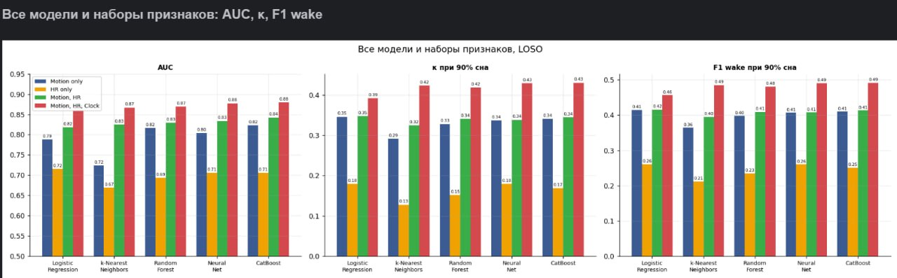

**Новые метрики: AP, PPV, macro F1 и F1 REM по всем моделям**

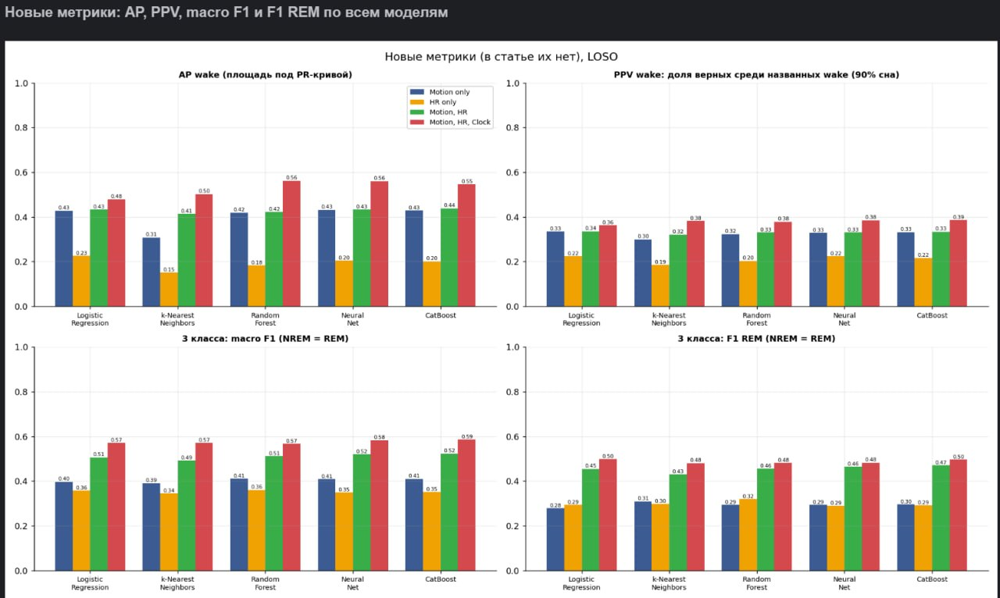

**F1 бодрствования в зависимости от порога, все модели**

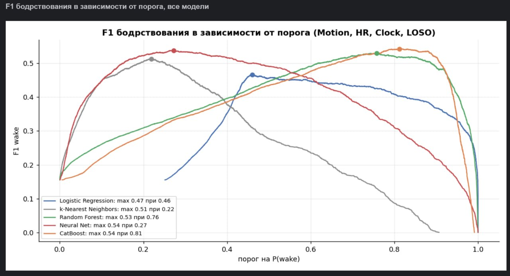

**Важность по Шепли: AUC на всех подмножествах признаков и вклад признаков**

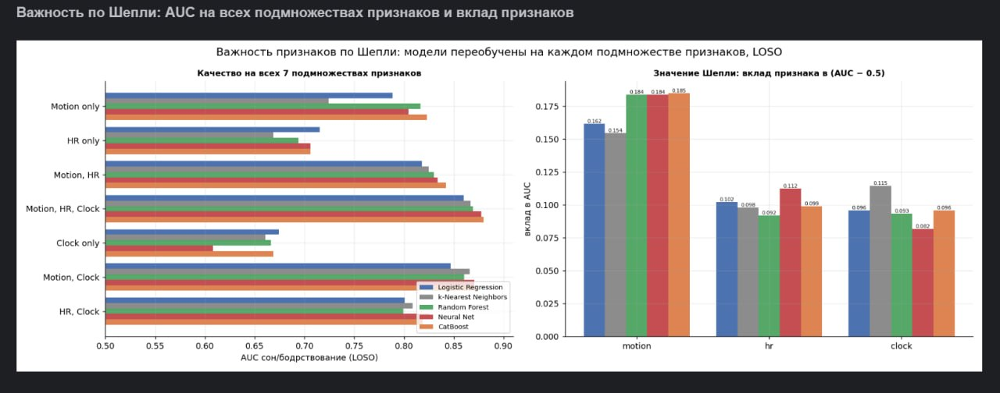

**Значения Шепли по AUC, AP wake, κ и F1 wake, все модели**

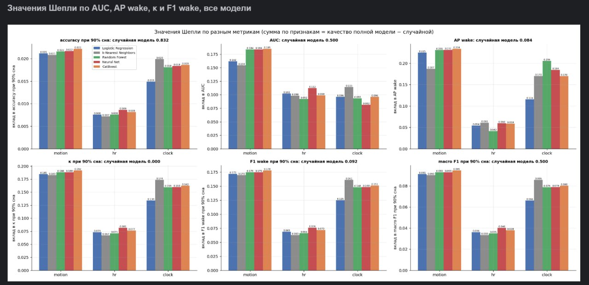

**Доля каждого признака в приросте качества (Шепли)**

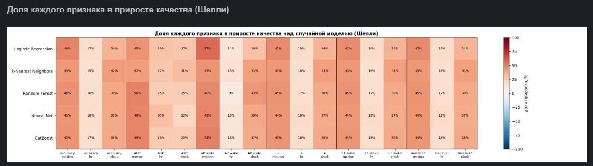

**SHAP: mean |SHAP| и доля признаков, все модели**

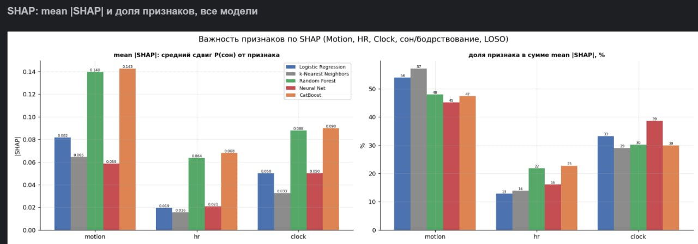

**SHAP-значения по эпохам, все модели**

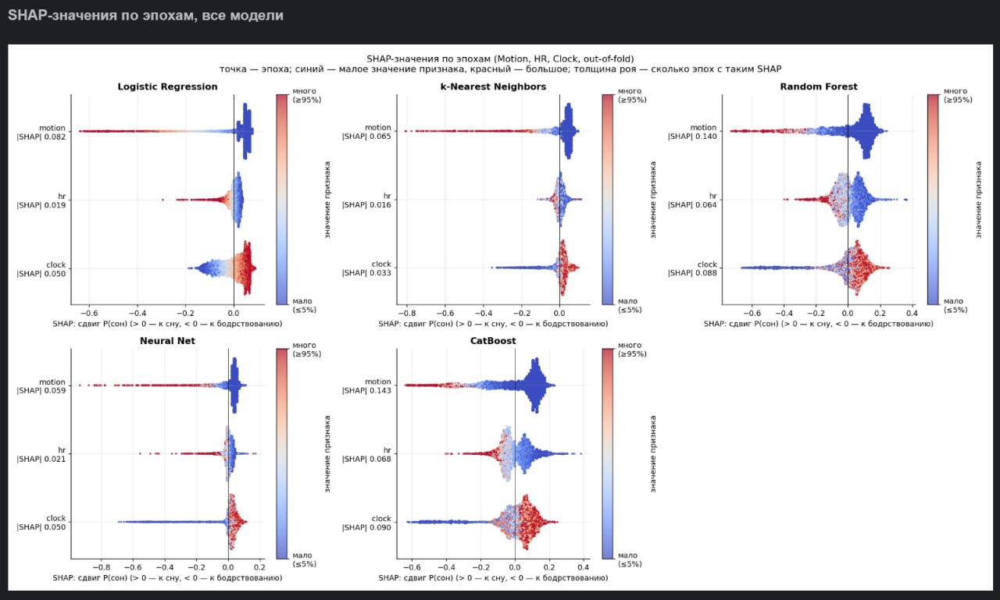

**SHAP dependence: как значение признака сдвигает P(сон)**

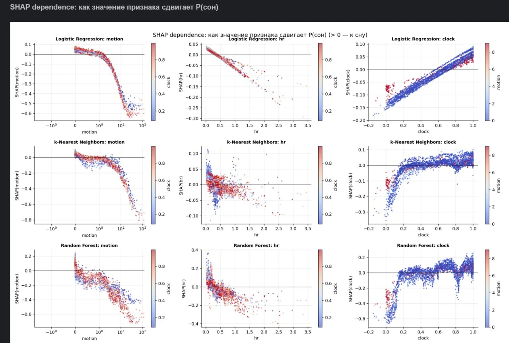

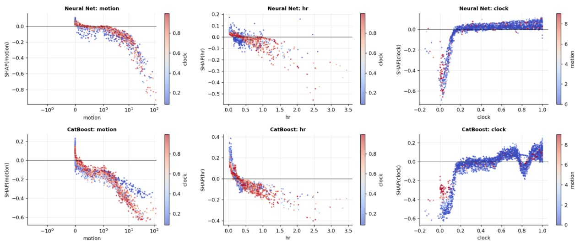

**Рис. 2: ROC сон/бодрствование, все модели**

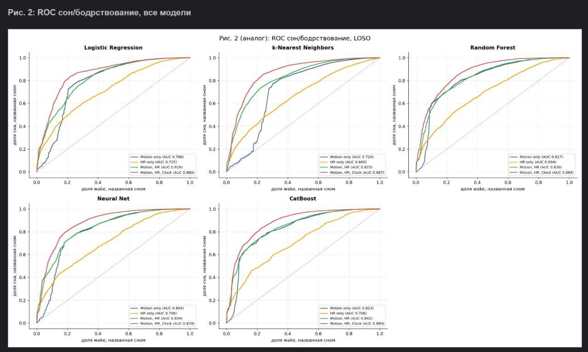

**Рис. 3: precision–recall для wake**

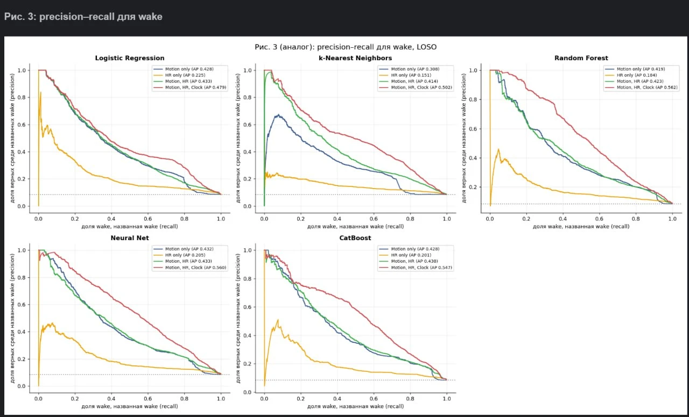

**Рис. 4: wake / NREM / REM**

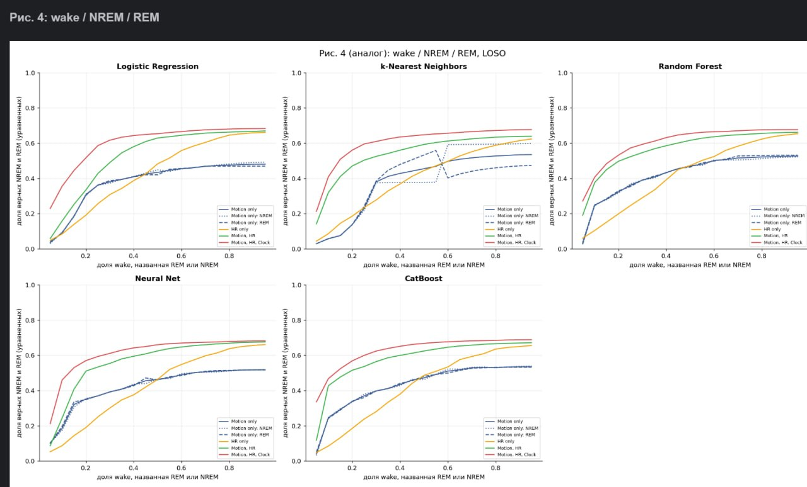

**Рис. 5, Bland–Altman — Логистическая регрессия**

_рисунок `fig5_bland_altman__logistic_regression.png` есть только в локальном прогоне (`outputs/repro/paper_metrics/`)_

**Рис. 6, качество по людям — Логистическая регрессия**

_рисунок `fig6_per_subject_theta__logistic_regression.png` есть только в локальном прогоне (`outputs/repro/paper_metrics/`)_

**Рис. 7, порог под человека — Логистическая регрессия**

_рисунок `fig7_per_subject_tpr__logistic_regression.png` есть только в локальном прогоне (`outputs/repro/paper_metrics/`)_

**Рис. 5, Bland–Altman — k ближайших соседей**

_рисунок `fig5_bland_altman__k_nearest_neighbors.png` есть только в локальном прогоне (`outputs/repro/paper_metrics/`)_

**Рис. 6, качество по людям — k ближайших соседей**

_рисунок `fig6_per_subject_theta__k_nearest_neighbors.png` есть только в локальном прогоне (`outputs/repro/paper_metrics/`)_

**Рис. 7, порог под человека — k ближайших соседей**

_рисунок `fig7_per_subject_tpr__k_nearest_neighbors.png` есть только в локальном прогоне (`outputs/repro/paper_metrics/`)_

**Рис. 5, Bland–Altman — Случайный лес**

_рисунок `fig5_bland_altman__random_forest.png` есть только в локальном прогоне (`outputs/repro/paper_metrics/`)_

**Рис. 6, качество по людям — Случайный лес**

_рисунок `fig6_per_subject_theta__random_forest.png` есть только в локальном прогоне (`outputs/repro/paper_metrics/`)_

**Рис. 7, порог под человека — Случайный лес**

_рисунок `fig7_per_subject_tpr__random_forest.png` есть только в локальном прогоне (`outputs/repro/paper_metrics/`)_

**Рис. 5, Bland–Altman — Нейросеть (MLP)**

_рисунок `fig5_bland_altman__neural_net.png` есть только в локальном прогоне (`outputs/repro/paper_metrics/`)_

**Рис. 6, качество по людям — Нейросеть (MLP)**

_рисунок `fig6_per_subject_theta__neural_net.png` есть только в локальном прогоне (`outputs/repro/paper_metrics/`)_

**Рис. 7, порог под человека — Нейросеть (MLP)**

_рисунок `fig7_per_subject_tpr__neural_net.png` есть только в локальном прогоне (`outputs/repro/paper_metrics/`)_

**Рис. 5, Bland–Altman — CatBoost**

_рисунок `fig5_bland_altman__catboost.png` есть только в локальном прогоне (`outputs/repro/paper_metrics/`)_

**Рис. 6, качество по людям — CatBoost**

_рисунок `fig6_per_subject_theta__catboost.png` есть только в локальном прогоне (`outputs/repro/paper_metrics/`)_

**Рис. 7, порог под человека — CatBoost**

_рисунок `fig7_per_subject_tpr__catboost.png` есть только в локальном прогоне (`outputs/repro/paper_metrics/`)_

### Все остальные рисунки

- `CatBoost_10__sw_pr.png`

- `CatBoost_10__sw_roc.png`

- `CatBoost_10__time_only_sw_pr.png`

- `CatBoost_10__time_only_sw_roc.png`

- `CatBoost_5__ovr_nrem_roc.png`

- `CatBoost_5__ovr_rem_roc.png`

- `CatBoost_5__ovr_wake_roc.png`

- `CatBoost_5__three_class_roc.png`

- `figure_10_sw_pr.png`

- `figure_10_sw_roc.png`

- `figure_10_time_only_sw_pr.png`

- `figure_10_time_only_sw_roc.png`

- `figure_5_ovr_nrem_roc.png`

- `figure_5_ovr_rem_roc.png`

- `figure_5_ovr_wake_roc.png`

- `figure_5_three_class_roc.png`

- `paper_metrics/fig5_bland_altman.png`

- `paper_metrics/fig6_per_subject_theta.png`

- `paper_metrics/fig7_per_subject_tpr.png`

Рисунок 1 статьи (пример ночи) для каждого испытуемого — файлы `data_validation_<id>.png`.
